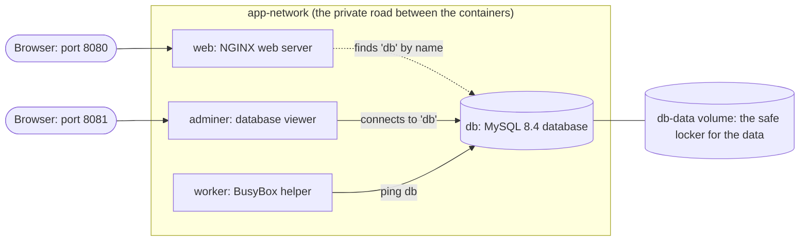

# Docker Compose Demo: Running Multi-Container Applications

[](https://github.com/gh-shad/compose-demo/actions/workflows/demo-test.yml)
[](LICENSE)


> **A fully automatic demo that teaches Docker Compose, Git and GitHub from zero.**
> You press **Enter once**. The script then runs every command by itself and explains
> each one in simple English, while it happens, on your screen.

---

## Contents

1. [What is this project?](#1-what-is-this-project)
2. [What you will learn](#2-what-you-will-learn)
3. [How the application looks](#3-how-the-application-looks)
4. [Quick start](#4-quick-start)
5. [What happens when you run it](#5-what-happens-when-you-run-it)
6. [The project files](#6-the-project-files)
7. [Options](#7-options)
8. [Safety: what is deleted, and what is never deleted](#8-safety-what-is-deleted-and-what-is-never-deleted)
9. [Automatic tests on GitHub](#9-automatic-tests-on-github)
10. [Full documentation](#10-full-documentation)
11. [Common problems](#11-common-problems)
12. [About this project](#12-about-this-project)

---

## 1. What is this project?

Most real applications are made of **several programs that work together**: a website,
a database, and some helpers. Starting them one by one is slow and easy to get wrong.

**Docker Compose** solves this. You describe all the programs in **one file**
(`docker-compose.yml`), and you start all of them with **one command**.

This project is a **live, self-explaining demo** of that idea. One script, `demo.sh`:

- starts a small application made of **4 containers** (website, database, database viewer, helper),
- proves that the containers can **talk to each other**, that the **data survives** a restart,
  and that a service can be **scaled** to more copies,
- **cleans up** everything temporary and **checks** that no project file was damaged,
- saves the project with **Git** and uploads it to **GitHub**, then **verifies** the upload,
- and ends with a **final confirmation screen** that lists the result of every check.

Before every command, the script shows a box that explains, in simple English, what the
command does. After the command, it shows what to look at in the result.

> **New to all of this?** That is fine. Every word (container, image, volume, commit, push...)
> is explained in [docs/02-concepts.md](docs/02-concepts.md).

---

## 2. What you will learn

| Topic | What you will see |
|---|---|
| Containers and images | What a container is, and why it is like a small sealed box |
| Docker Compose | How one YAML file describes a whole application |
| Services | Four containers, each with one job |
| Networks | Containers finding each other **by name** (`ping db`) |
| Ports | How "door 8080" on your computer reaches "door 80" in a container |
| Volumes | Data that survives even when all containers are deleted |
| Scaling | Running 3 copies of a service with one option |
| Logs | Reading what containers print |
| Clean up | Removing only what the demo created, safely |
| File safety | Using SHA-256 "fingerprints" to prove files are unchanged |
| Git | `init`, `status`, `add`, `commit`, `log`, `diff` |
| GitHub | Logging in, creating a project, `push`, and checking the upload |
| GitHub Actions | GitHub running this whole demo by itself after every upload |

---

## 3. How the application looks



| Service | Image | What it does | How to reach it |
|---|---|---|---|
| `web` | `nginx:latest` | A web server. Shows the page in `html/index.html` | `http://<VM-address>:8080` |
| `db` | `mysql:8.4` | A MySQL database. Keeps its data in the `db-data` volume | Only inside the network, by the name `db` |
| `adminer` | `adminer:latest` | A web page to look inside the database | `http://<VM-address>:8081` |
| `worker` | `busybox:latest` | A tiny helper that prints a message every 5 seconds. Used to show scaling | (no port) |

---

## 4. Quick start

Pick **one** of the three options.

### Option 1: Windows, with one click (recommended)

You need: Windows 10 or 11 **Pro**, an internet connection, and (for the upload) a free GitHub account.

1. Install **Multipass** from <https://canonical.com/multipass/install> and restart Windows.
2. Download this project: green **Code** button at the top of this page → **Download ZIP**.
   Right-click the ZIP → **Extract All**.
3. Open the folder and **double-click `Start-Demo.bat`**.
4. The first time only, it creates the demo computer (takes about 10 minutes), and it asks
   if you want to upload to GitHub (a one-time login with a code).
5. When you see **Press Enter to start the demo**, press **Enter**. Everything else runs by itself.

The full step-by-step guide, with every click, is in
[docs/01-setup-from-zero.md](docs/01-setup-from-zero.md).

### Option 2: Any Linux computer that has Docker

```bash
git clone https://github.com/gh-shad/compose-demo.git
cd compose-demo
./demo.sh
```

You need Docker with the Compose plugin (`docker compose version` must work) and Git.
The GitHub CLI (`gh`) is only needed for the upload part.

### Option 3: Just watch it, without installing anything

GitHub runs the whole demo by itself after every upload. Open the
[**Actions** tab](https://github.com/gh-shad/compose-demo/actions), click the newest
**Demo test** run, then **Run the whole Docker demo** → **Run demo.sh**. You see every command
and every explanation, exactly as they appear in a terminal.

---

## 5. What happens when you run it

The whole demo takes about **15 minutes** at normal speed (`--fast` takes about 2 minutes).

| Part | Title | What happens |
|---|---|---|
| Start | Getting ready | Checks Docker, Compose, the images and Git, makes a safety fingerprint of every file, and connects to GitHub |
| 1 | Opening | What the demo is about |
| 2 | The problem | Why starting many containers by hand is hard |
| 3 | Three building blocks | Services, networks and volumes, with a diagram |
| 4 | The YAML file | `docker-compose.yml`, explained line by line |
| 5 | Start the whole app | `docker compose up -d`, `docker compose ps`, the web page |
| 6 | Containers talking | `ping db`, `getent hosts db`, Adminer connects to the database |
| 7 | Data survives a restart | Save data, delete all containers, start again: the data is still there |
| 8 | Scaling and logs | `--scale worker=3` and `docker compose logs` |
| 9 | Stop and remove the app | `docker compose down --volumes` |
| 10 | Clean up and safety check | Removes everything temporary and checks every file with SHA-256 |
| 11 | Save with Git | `git init`, `add`, `commit`, `log`, `diff` |
| 12 | Upload to GitHub | `gh` login check, `git push` or `gh repo create`, then proof that GitHub has the same commit |
| End | Final confirmation | A list of every check with PASSED or FAILED, and the GitHub address |

Every part, and every command in it, is explained in
[docs/04-demo-walkthrough.md](docs/04-demo-walkthrough.md).

---

## 6. The project files

```text
compose-demo/
├── README.md                  <- this page
├── demo.sh                    <- the automatic demo script (runs in Linux)
├── docker-compose.yml         <- the application: 4 services, 1 network, 1 volume
├── html/
│   └── index.html             <- the web page that the web container shows
├── Start-Demo.bat             <- double-click this on Windows
├── Start-Demo.ps1             <- the Windows launcher (Start-Demo.bat runs it)
├── cloud-init.yaml            <- sets up the Linux VM: installs Docker, Git and gh
├── .github/workflows/
│   └── demo-test.yml          <- automatic tests that GitHub runs after every upload
├── docs/                      <- the full documentation (see section 10)
│   └── demo-runs.md           <- one line is added each time the demo saves with Git
├── .gitignore                 <- files that Git must never upload
├── .gitattributes             <- line-ending rules for Windows and Linux files
└── LICENSE                    <- MIT license: anyone may use and change this project
```

Every file, and every important line in it, is explained in
[docs/06-files-explained.md](docs/06-files-explained.md).

---

## 7. Options

Type them after the script name, for example `./demo.sh --slow`, or `Start-Demo.bat --slow` on Windows.

| Option | What it does |
|---|---|
| *(none)* | Automatic: press Enter once, then it runs by itself |
| `--slow` | Automatic, with more time to read each explanation |
| `--manual` | Waits for you to press Enter before every step |
| `--fast` | No pauses at all (about 2 minutes). Used by the automatic tests |
| `--setup` | Only the checks and the one-time GitHub login, then stops |
| `--keep` | Leaves the containers running at the end, so you can explore them |
| `--no-git` | Only the Docker part and the clean up (Parts 1 to 10) |
| `--git-only` | Only the clean up, Git and GitHub (Parts 10 to 12) |
| `--no-push` | Uses Git, but does not upload to GitHub |
| `--push` | Logs in to GitHub without asking first |
| `--help` | Shows the list of options |

While it runs: **Enter** skips the current pause, **p** pauses, **Ctrl+C** stops.

---

## 8. Safety: what is deleted, and what is never deleted

Part 10 cleans up **before** anything is uploaded. It follows one rule:
**only remove what this demo created.**

| Removed | Never touched |
|---|---|
| This project's containers, network and volume (found by their Docker label) | Your other Docker containers, images and projects |
| The script's own temporary folder `/tmp/compose-demo-run.XXXXXX` (the path is checked first) | Any other file or folder on the computer |
| Old update packages of the Windows launcher in `/tmp` | The project files (they are checked with SHA-256 fingerprints instead) |
| | Your Git history (`.git`) and your projects on GitHub (nothing is ever overwritten or deleted there) |

The 4 Docker images are **kept on purpose**, so the next run works even without internet.
Details, and how to remove everything by hand: [docs/08-cleanup-and-safety.md](docs/08-cleanup-and-safety.md).

---

## 9. Automatic tests on GitHub

The file `.github/workflows/demo-test.yml` tells GitHub to test the project after every upload.
GitHub starts fresh computers and runs three jobs:

1. **Check the files**: checks `demo.sh` with ShellCheck and `docker-compose.yml` with Docker Compose.
2. **Run the whole Docker demo**: really runs `bash demo.sh --fast --no-git` with the real images.
3. **Check the Windows launcher**: checks `Start-Demo.ps1` with Windows PowerShell 5.1 on Windows.

The green **Demo test: passing** badge at the top of this page means all three jobs passed.

---

## 10. Full documentation

| Document | What is inside |
|---|---|
| [01 - Setup from zero](docs/01-setup-from-zero.md) | Every step on Windows, from nothing installed to the finished demo (plus macOS and Linux) |
| [02 - Concepts](docs/02-concepts.md) | Every idea and word explained simply: container, image, volume, Git, commit, push... |
| [03 - The docker-compose.yml file](docs/03-docker-compose-file.md) | The application file, line by line |
| [04 - Demo walkthrough](docs/04-demo-walkthrough.md) | All 12 parts: every command, what it does, and what you see |
| [05 - Git and GitHub](docs/05-git-and-github.md) | Every Git and GitHub step, how the upload is decided and verified, and the automatic tests |
| [06 - Every file explained](docs/06-files-explained.md) | What each file does, including the script, the launcher and cloud-init |
| [07 - Commands reference](docs/07-commands-reference.md) | Every command used in this project, in one place |
| [08 - Clean up and safety](docs/08-cleanup-and-safety.md) | What is created, what is removed, what is protected, and manual clean up |
| [09 - Troubleshooting](docs/09-troubleshooting.md) | Common problems, their fixes, and questions and answers |
| [Demo run history](docs/demo-runs.md) | One line for every run that was saved with Git |

---

## 11. Common problems

| Problem | Fix |
|---|---|
| Multipass will not start | Set your Wi-Fi network to **Private**, and check that Hyper-V is turned on |
| "Windows protected your PC" | Click **More info**, then **Run anyway** (it appears for every downloaded file) |
| The browser cannot open the page | Use the address that the script prints (not `localhost`) |
| Adminer login fails | Wait 30 seconds (MySQL is still starting), then try again |
| The upload was skipped | Run `./demo.sh --setup` once to log in to GitHub, then run the demo again |

More problems and answers: [docs/09-troubleshooting.md](docs/09-troubleshooting.md).

---

## 12. About this project

Made by **Mohamed Shadhil H**, B.Tech CSE (Cyber Security), as a classroom demonstration of
running multi-container applications with Docker Compose.

The project is free to use, copy, change and share, under the [MIT License](LICENSE).
If it helped you, give it a star on GitHub.
