# Docker Compose Demo: Running Multi-Container Applications

[](https://github.com/gh-shad/compose-demo-2/actions/workflows/demo-test.yml)
[](https://codespaces.new/gh-shad/compose-demo-2?quickstart=1)
[](LICENSE)
[](SECURITY.md)


> **A complete, fully automatic lesson about Docker Compose, Git and GitHub.**
> You press **Enter once**. The script then runs every command by itself, explains each one in
> simple English, checks every result, cleans up safely, writes a results report, uploads your
> work to **your own** GitHub account, verifies the upload, and signs out again.

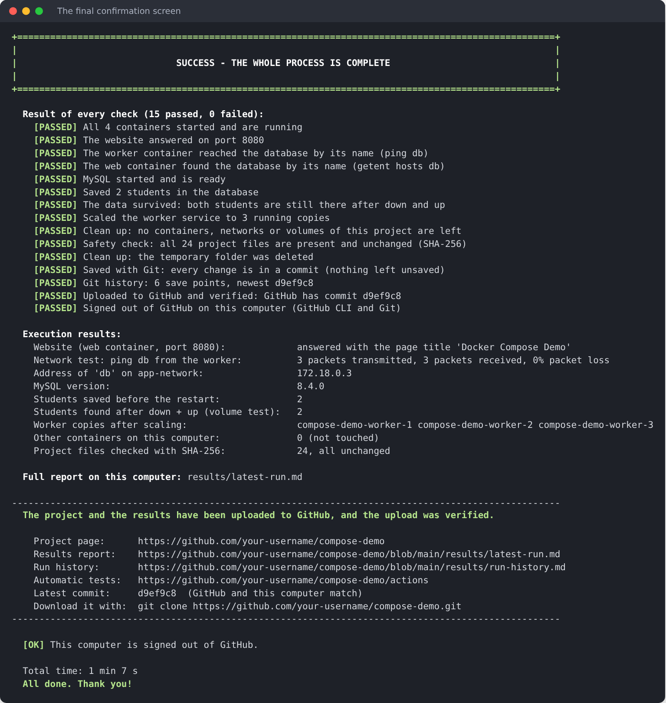

---

## Contents

1. [Project overview](#1-project-overview)
2. [Objectives](#2-objectives)
3. [Features](#3-features)
4. [Screenshots](#4-screenshots)
5. [Technologies and tools](#5-technologies-and-tools)
6. [How it works](#6-how-it-works)
7. [Quick start](#7-quick-start)
8. [Installation and setup](#8-installation-and-setup)
9. [Running the demo](#9-running-the-demo)
10. [How to use each feature](#10-how-to-use-each-feature)
11. [Your results](#11-your-results)
12. [Uploading the project to GitHub](#12-uploading-the-project-to-github)
13. [Sharing the project with your teacher](#13-sharing-the-project-with-your-teacher)
14. [For teachers: using this project in class](#14-for-teachers-using-this-project-in-class)
15. [The development process, step by step](#15-the-development-process-step-by-step)
16. [Project structure](#16-project-structure)
17. [Safety and security](#17-safety-and-security)
18. [Troubleshooting](#18-troubleshooting)
19. [Questions and answers](#19-questions-and-answers)
20. [Full documentation](#20-full-documentation)
21. [Version history, license and credits](#21-version-history-license-and-credits)

---

## 1. Project overview

Most real applications are **several programs that work together**: a website, a database and
some helpers. Starting them one by one, by hand, is slow and easy to get wrong.

**Docker Compose** solves this: you describe all the programs in **one file**
(`docker-compose.yml`) and start them with **one command** (`docker compose up -d`).

This project is a **live, self-explaining demonstration** of that idea, built for a classroom.
One script, `demo.sh`, runs a complete session in **13 parts**:

| Stage | Parts | What the audience sees |
|---|---|---|
| **Understand** | 1 to 4 | The problem, the three building blocks, and the compose file, line by line |
| **Run** | 5 to 9 | A 4-container application starts, the containers talk to each other, data survives a restart, a service is scaled, and everything is removed |
| **Clean and check** | 10 | Everything temporary is removed, and SHA-256 fingerprints prove that no project file was damaged |
| **Save and share** | 11 and 12 | A results report is written, saved with Git, uploaded to GitHub, and the upload is verified |
| **End safely** | 13 | The computer signs out of GitHub again |
| **Confirm** | End | A final screen with every check, the key results and the project links |

Before every command, a box explains **what the command does**. After it, a box explains
**what to look at in the result**. No experience is needed: every word is explained in
[docs/02-concepts.md](docs/02-concepts.md).

---

## 2. Objectives

### Learning objectives (what a student can do after the demo)

1. Explain what a **container**, an **image**, a **service**, a **network**, a **port** and a **volume** are.
2. Read and explain a `docker-compose.yml` file line by line.
3. Start, inspect, scale, and remove a multi-container application with `docker compose`.
4. Prove that containers find each other **by name**, and that a **volume** keeps data safe.
5. Save work with **Git** (`init`, `status`, `add`, `commit`, `log`, `diff`).
6. Upload work to **GitHub** (`push`), download changes (`pull`), and use **forks**.
7. Sign in and **sign out** of GitHub safely on a shared computer.

### Project objectives (what the project itself must do)

| Objective | How it is met |
|---|---|
| Fully automatic | Press Enter once. Every command runs by itself |
| Easy to understand | Every command is explained in simple English before and after it runs |
| Reliable | Every important result is checked and recorded. The exit code shows success or failure |
| Safe | Only removes what the demo created. Never overwrites anything on GitHub. Signs out at the end |
| Usable by anyone | Runs in GitHub Codespaces (no install), on Windows (one click), or on any Linux with Docker |
| Proof of results | A results report is written and uploaded, and the upload is verified with GitHub itself |
| Well documented | This README, 11 guides (including a teaching guide), real screenshots, and a changelog |

---

## 3. Features

| Feature | What it does | Where |
|---|---|---|
| **Narrated automatic demo** | Runs 13 parts and more than 50 commands by itself, each explained in simple English | `demo.sh` |
| **Four speeds** | Automatic, `--slow`, `--manual` (Enter before every step), `--fast` | [10.1](#101-speeds-automatic-slow-manual-fast) |
| **Real 4-container application** | NGINX website, MySQL 8.4 database, Adminer database viewer, BusyBox worker | `docker-compose.yml` |
| **Live checks** | Records up to 17 checks (containers running, website answers, security headers, ping, data survives, scaling, clean up, upload, sign-out...) | Final screen |
| **Safe clean up** | Removes only this project's containers, network, volume and temporary files | Part 10 |
| **File safety check** | SHA-256 fingerprints of every project file at the start and before the upload | Part 10 |
| **Results report** | `results/latest-run.md` with every check, key results, time per part, versions | Part 11 |
| **Git lesson** | `init`, `status`, `add`, `commit`, `log`, `diff`, with real output | Part 11 |
| **GitHub upload** | Push to your project or fork, create a fork, or create a new project. Never overwrites anything | Part 12 |
| **Upload verification** | Compares the newest commit on the computer with the one on GitHub | Part 12 |
| **Complete sign-out** | Removes the GitHub CLI key and Git's GitHub settings, then checks | Part 13, `--logout` |
| **Final confirmation** | Every check (PASSED/FAILED), execution results, project and report links | End |
| **GitHub Codespaces** | Runs in the browser with nothing to install | `.devcontainer/` |
| **One-click Windows launcher** | Creates the VM, copies the project, opens the browser pages, runs the demo | `Start-Demo.bat` |
| **Automatic tests** | GitHub runs the demo after every upload and shows the report | `.github/workflows/` |
| **Self-repair** | Re-creates missing project files. Backs up unsaved changes before an update | `demo.sh` |
| **Security hardening** | Fixed image versions, `no-new-privileges`, read-only worker, security headers, hidden server version, checked live | `docker-compose.yml`, `nginx/` |
| **Security policy** | What protects you, which choices are demo-only, and how to report a problem privately | [SECURITY.md](SECURITY.md) |
| **Automatic updates** | Dependabot suggests newer actions, images and Codespaces features once a month, tested before merging | `.github/dependabot.yml` |

---

## 4. Screenshots

These are real screens of `demo.sh`, captured in a terminal during a test run.
Your addresses, user name and commit IDs will be different.

**Getting ready:** the checks before the demo, and the plan of all parts.

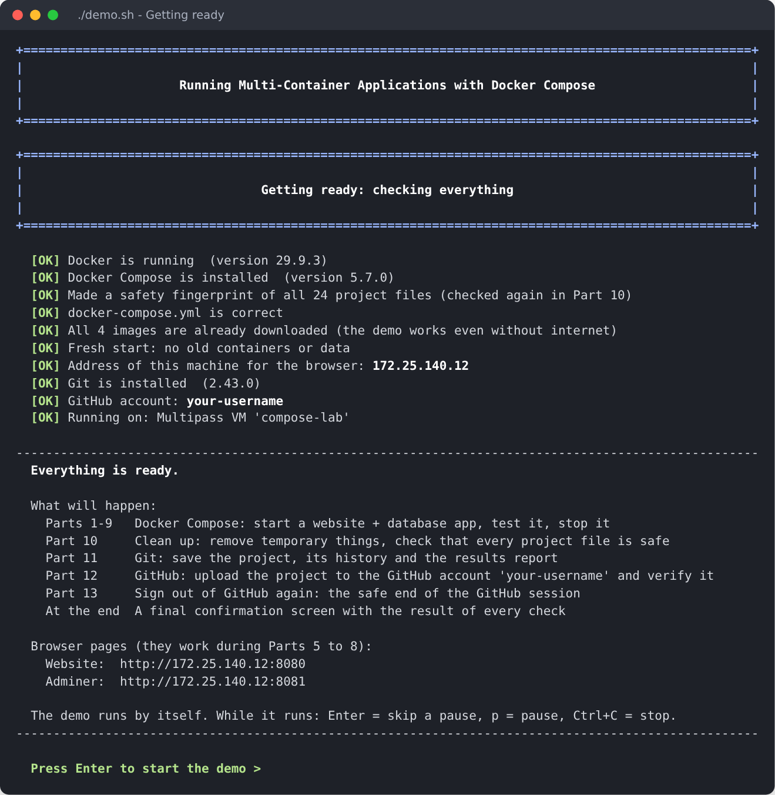

**Part 5:** an explanation, the real command, its real output, and what to look at.

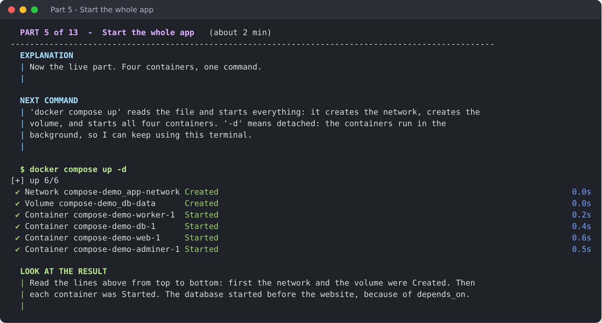

**The website** that the `web` container serves on port 8080:

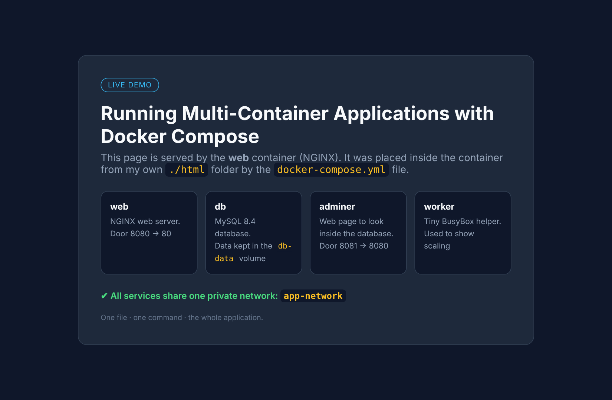

<details>
<summary><b>More screenshots (click to open)</b></summary>

**Part 6:** the containers find each other by name.

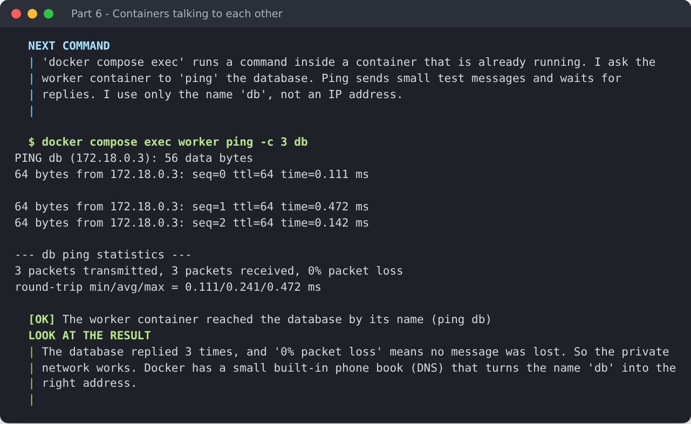

**Part 7:** the data is still there after all containers were deleted and started again.

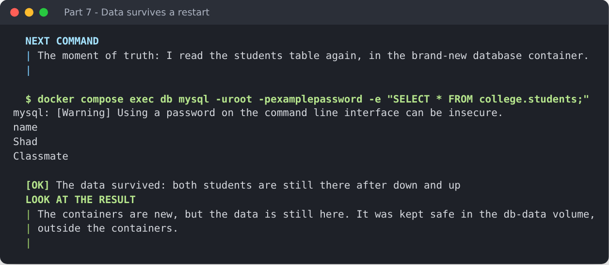

**Part 8:** three copies of the worker, each with its own name.

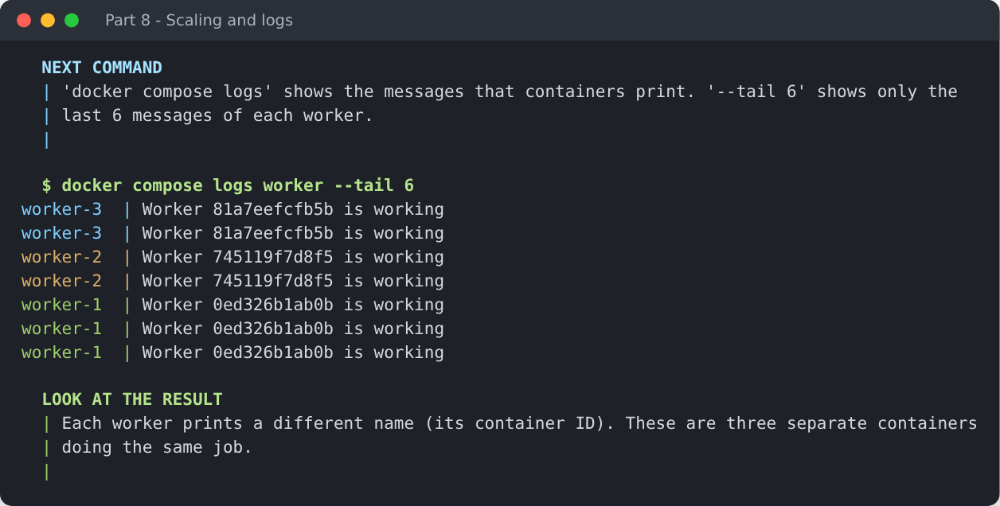

**Part 10:** only this project's things are checked and removed, and every file is checked with SHA-256.

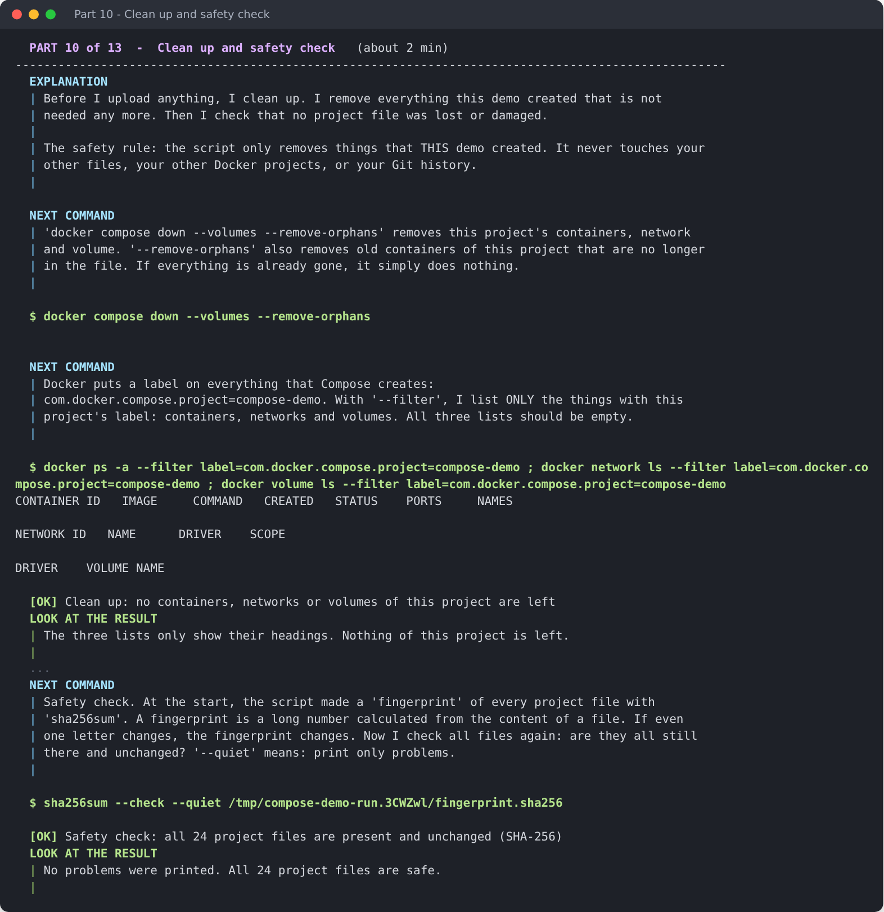

**Part 11:** Git shows exactly what changed, and saves it.

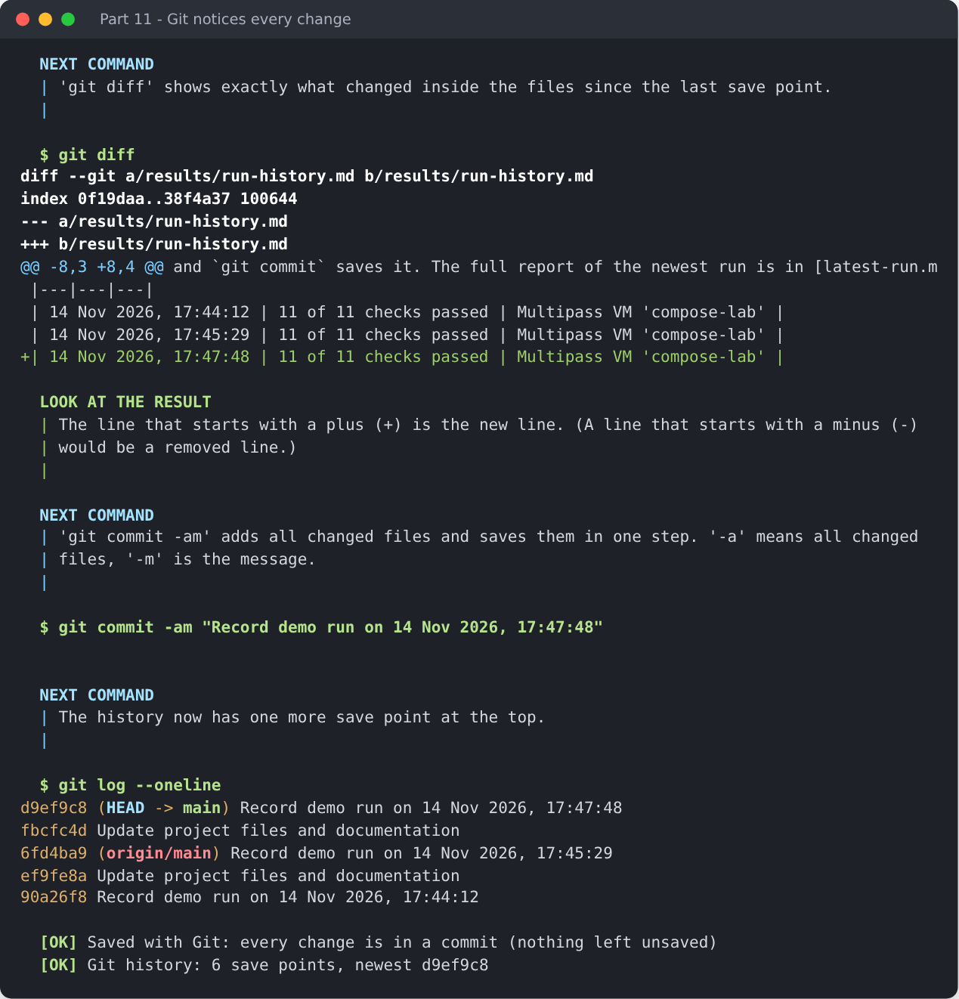

**The GitHub sign-in with a one-time code** (outside Codespaces):

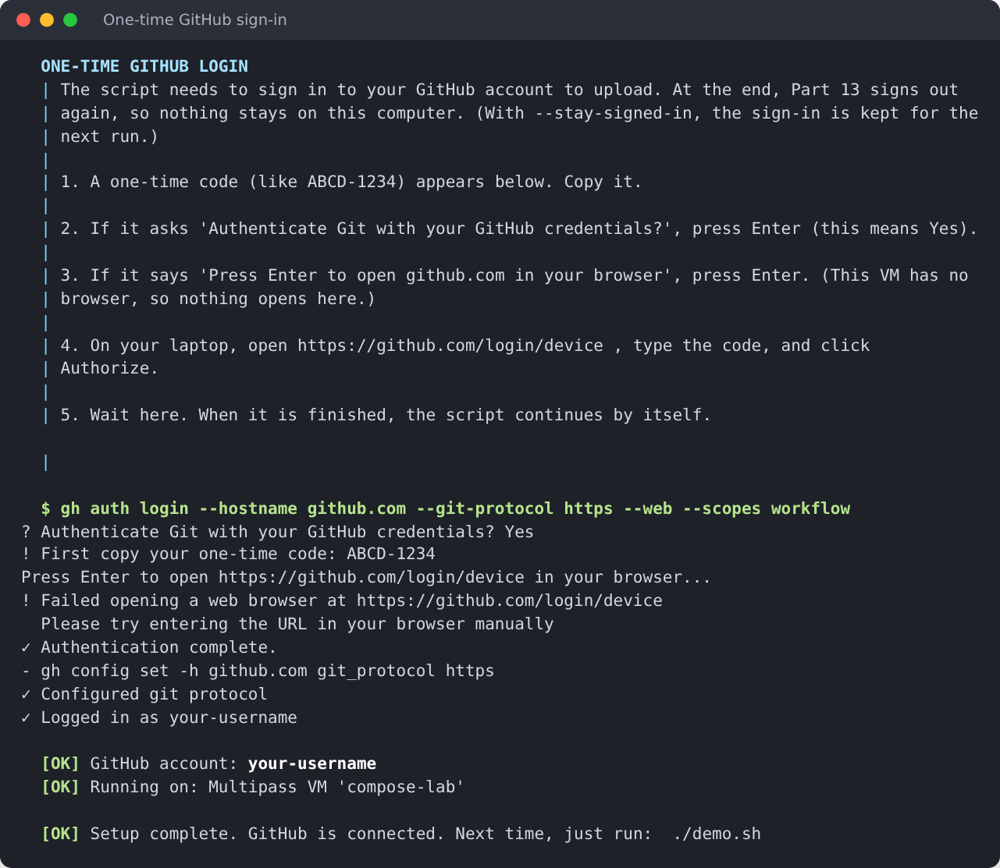

**Part 12:** the upload is verified by asking GitHub for its newest commit.

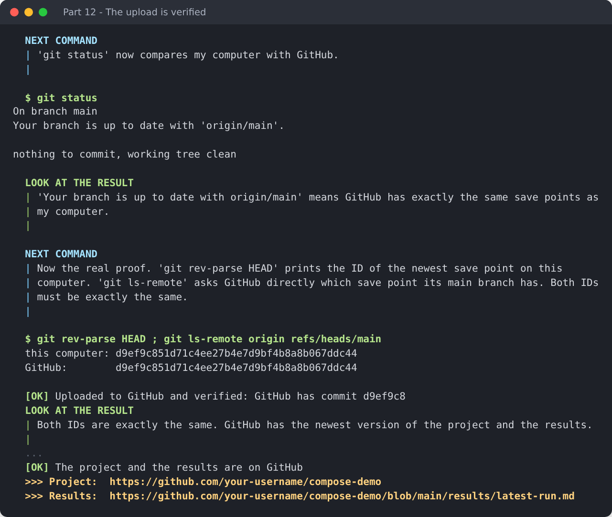

**Part 13:** a complete sign-out of GitHub.

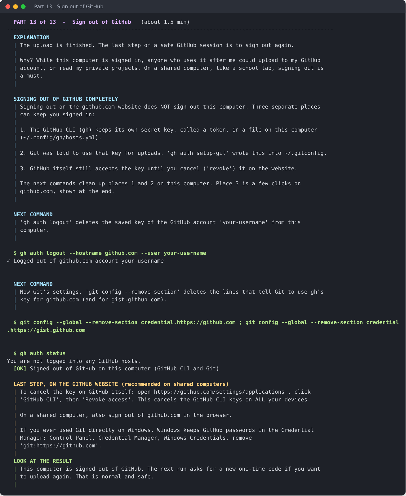

</details>

---

## 5. Technologies and tools

| Tool | Version used | What it is | What it does in this project |
|---|---|---|---|
| **Docker Engine** | 24 or newer | Runs containers | Runs the 4 containers |
| **Docker Compose** | v2 or newer (`docker compose`) | Starts many containers from one file | Starts, scales and removes the application |
| **NGINX** | `nginx:1.30` | Web server | The `web` service: shows `html/index.html` |
| **MySQL** | `mysql:8.4` (long-term support) | Database server | The `db` service: stores the students table |
| **Adminer** | `adminer:6` | Web page for databases | The `adminer` service: look inside MySQL |
| **BusyBox** | `busybox:1.37` | Tiny Linux toolbox | The `worker` service: `ping` and scaling |
| **Bash** | 5.x | Linux shell | `demo.sh` is a Bash script |
| **Git** | 2.x | Version control | Saves the project and its history |
| **GitHub** | — | Website for Git projects | Hosts the project, forks and results |
| **GitHub CLI (`gh`)** | 2.x | GitHub's command-line tool | Sign in, fork, create, check, sign out |
| **GitHub Actions** | — | GitHub's automatic task runner | Tests the project after every upload |
| **GitHub Codespaces** | — | Cloud computer in the browser | Run the demo with nothing installed |
| **Multipass** | 1.x | Creates Ubuntu VMs | The `compose-lab` VM on Windows/macOS/Linux |
| **cloud-init** | — | First-start setup of Linux machines | Installs Docker, Git and gh in the VM |
| **Ubuntu** | 24.04 LTS | Linux operating system | The VM's system |
| **PowerShell** | 5.1 (Windows) | Windows scripting | `Start-Demo.ps1`, the Windows launcher |
| **SHA-256** (`sha256sum`) | — | File fingerprints | Proves that no file was damaged |
| **Markdown, Mermaid** | — | Documentation formats | This README, the guides, the diagrams |
| **ShellCheck, actionlint** | — | Code checkers | Find mistakes in the script and the workflow |
| **Python 3** | 3.x | Programming language | `.github/scripts/check-links.py` checks every documentation link |
| **Dependabot** | — | GitHub's update robot | Suggests newer versions of the actions, images and Codespaces features |

---

## 6. How it works

### The application

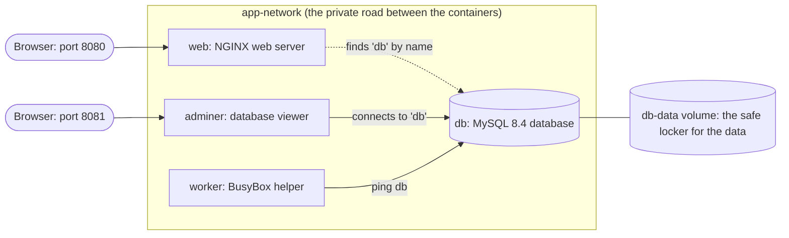

| Service | Image | What it does | How to reach it |
|---|---|---|---|
| `web` | `nginx:1.30` | Shows `html/index.html` | Port **8080** |
| `db` | `mysql:8.4` | Stores data in the `db-data` volume | Only inside the network, by the name `db` |
| `adminer` | `adminer:6` | A web page to look inside the database | Port **8081** |
| `worker` | `busybox:1.37` | Prints a message every 5 seconds | (no port) |

Line-by-line explanation of the file: [docs/03-docker-compose-file.md](docs/03-docker-compose-file.md).

### The session

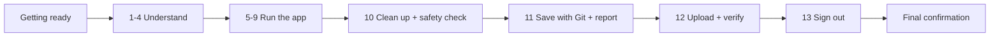

### Where it can run

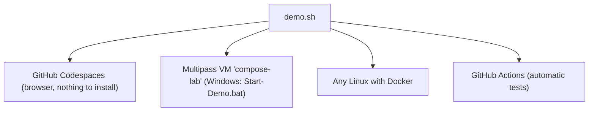

---

## 7. Quick start

| | Way | You need | GitHub sign-in | Best for |
|---|---|---|---|---|
| **A** | **GitHub Codespaces** | A browser + free GitHub account | Automatic | Students and teachers, any computer |
| **B** | **Windows, one click** | Windows 10/11 **Pro** + Multipass | One-time code | Presenting in class, works without Wi-Fi after setup |
| **C** | **Any Linux with Docker** | Docker, Git, (gh) | One-time code | People who already use Linux |
| **D** | **Just watch** | Nothing | Not needed | Seeing a complete real run in one minute |

**A. Codespaces:** click **Fork** on this page → on **your fork**: **Code** → **Codespaces** →
**Create codespace on main** → in the terminal type `./demo.sh` → press **Enter**.

**B. Windows:** install [Multipass](https://canonical.com/multipass/install) → **Code** → **Download ZIP**
→ extract → double-click **`Start-Demo.bat`** → press **Enter**.

**C. Linux:** `git clone https://github.com/gh-shad/compose-demo-2.git && cd compose-demo && ./demo.sh`

**D. Just watch:** open the [Actions tab](https://github.com/gh-shad/compose-demo-2/actions) → the newest
**Demo test** run → the results report is on its summary page.

---

## 8. Installation and setup

### Way A: GitHub Codespaces (recommended)

1. Sign in to <https://github.com>, or create a free account (**Sign up**).
2. On this project's page, click **Fork** (top right) → **Create fork**.
   You now have your own copy: `https://github.com/<you>/compose-demo`.
3. On **your fork**, click the green **Code** button → **Codespaces** tab → **Create codespace on main**.
4. Wait 1 to 2 minutes. An editor opens in your browser, with a **terminal** at the bottom.
5. Type `./demo.sh` and press **Enter**.

There is nothing to install and no sign-in code: the codespace is already signed in to your account.
Free GitHub accounts include a monthly amount of free Codespaces time. When you are finished,
stop the codespace at <https://github.com/codespaces> (three dots → **Stop codespace**).

### Way B: Windows with the one-click launcher

| Step | What to do | Why |
|---|---|---|
| 1 | Press **Win + R**, type `winver`, press Enter. It must say **Pro**, Enterprise or Education | Multipass needs Hyper-V, which Windows Home does not have |
| 2 | Start → **Terminal (Admin)** → `Enable-WindowsOptionalFeature -Online -FeatureName Microsoft-Hyper-V -All` → restart if asked | Turns on Hyper-V |
| 3 | Settings → Network & internet → Wi-Fi → your network → **Private network** | Windows blocks the VM on public networks |
| 4 | Install Multipass from <https://canonical.com/multipass/install>, choose **Hyper-V**, restart Windows | Creates the Linux VM |
| 5 | Check in PowerShell: `multipass version` | Shows that it works |
| 6 | On GitHub: **Code** → **Download ZIP** → right-click the ZIP → **Extract All** | Gets the project |
| 7 | Double-click **`Start-Demo.bat`**. If Windows says "Windows protected your PC": **More info** → **Run anyway** | Starts the launcher |
| 8 | The first time, wait about 10 minutes while the VM `compose-lab` is created | `cloud-init.yaml` installs Docker, Git, gh and the images |

Every click, with explanations: [docs/01-setup-from-zero.md](docs/01-setup-from-zero.md).

### Way C: Any Linux computer with Docker

```bash
docker compose version      # must show version 2 or newer
git --version
git clone https://github.com/gh-shad/compose-demo-2.git
cd compose-demo
./demo.sh
```

For the upload, also install the GitHub CLI: <https://cli.github.com>.
On macOS or Linux, you can also create the same VM as on Windows:
`multipass launch 24.04 --name compose-lab --cpus 2 --memory 4G --disk 15G --cloud-init cloud-init.yaml --timeout 1500`.

---

## 9. Running the demo

1. Start it: `./demo.sh` (or double-click `Start-Demo.bat` on Windows).
2. **Getting ready** checks everything. Outside Codespaces, it asks:
   **"Upload the project to GitHub at the end?"** Type **y** + Enter to sign in with a one-time
   code, or just press **Enter** for No.
3. Press **Enter** at **Press Enter to start the demo**. From now on, everything is automatic.
4. Watch the screen:

| On the screen | Meaning |
|---|---|
| `PART 5 of 13 - Start the whole app` | A new part begins |
| **EXPLANATION** (blue box) | What is happening, in simple English |
| **NEXT COMMAND** (blue box) | What the next command does, before it runs |
| Green line starting with `$` | The real command. Below it: its real output |
| **LOOK AT THE RESULT** (green box) | What the output means |
| `[OK]` / `[PROBLEM]` / `NOTE:` | A passed check / a failed check with a hint / extra information |

**Keys while it runs:** **Enter** skips the current pause · **p** pauses · **Ctrl+C** stops.

### The 13 parts

| Part | Title | Main commands | About |
|---|---|---|---|
| 1 | Opening | — | 1 min |
| 2 | The problem | (6 long `docker run` commands vs. 1 compose command) | 1.5 min |
| 3 | Three building blocks | (services, networks, volumes, diagram) | 1.5 min |
| 4 | The YAML file | `cat docker-compose.yml`, `docker compose version` | 2 min |
| 5 | Start the whole app | `docker compose up -d`, `docker compose ps`, `curl` | 2 min |
| 6 | Containers talking to each other | `docker compose exec worker ping -c 3 db`, `getent hosts db` | 2 min |
| 7 | Data survives a restart | `mysql ... CREATE/INSERT/SELECT`, `docker compose down`, `up -d` | 2 min |
| 8 | Scaling and logs | `docker compose up -d --scale worker=3`, `docker compose logs` | 1.5 min |
| 9 | Stop and remove the app | `docker compose down --volumes` | 1 min |
| 10 | Clean up and safety check | `down --remove-orphans`, `--filter label=...`, `sha256sum --check`, `rm -rf` | 2 min |
| 11 | Save the project and the results with Git | report, `git init`, `add`, `commit`, `log`, `diff` | 3 min |
| 12 | Upload the project and the results to GitHub | `gh auth status`, `git push` / `gh repo fork` / `gh repo create`, `git ls-remote` | 3 min |
| 13 | Sign out of GitHub | `gh auth logout`, `git config --remove-section`, `gh auth status` | 1.5 min |

Every command of every part, explained: [docs/04-demo-walkthrough.md](docs/04-demo-walkthrough.md).

---

## 10. How to use each feature

### 10.1 Speeds: automatic, slow, manual, fast

| Command | Use it when |
|---|---|
| `./demo.sh` | Normal presenting. Press Enter once, then it runs by itself (about 15 to 20 minutes) |
| `./demo.sh --slow` | The audience needs more time to read (about 20 to 25 minutes) |
| `./demo.sh --manual` | You want to talk freely: it waits for Enter before every step |
| `./demo.sh --fast` | A quick test (about 2 to 3 minutes, no pauses) |

### 10.2 Choosing parts

| Command | Runs |
|---|---|
| `./demo.sh --no-git` | Parts 1 to 10 (Docker and clean up, no Git, no GitHub) |
| `./demo.sh --git-only` | Parts 10 to 13 (clean up, Git, GitHub, sign out) |
| `./demo.sh --no-push` | Everything, but no upload |

### 10.3 Exploring the running application (`--keep`)

`./demo.sh --keep` leaves the containers running at the end. Then try:

```bash
docker compose ps                     # what is running
docker compose logs web --tail 20     # messages of the web server
docker compose exec db mysql -uroot -pexamplepassword -e "SHOW DATABASES;"
docker compose down --volumes         # remove everything when you are done
```

### 10.4 The browser pages

| Page | Multipass VM | Codespaces |
|---|---|---|
| Website | `http://<VM address>:8080` (the launcher opens it by itself) | **Ports** tab → port **8080** → globe icon |
| Adminer | `http://<VM address>:8081` | **Ports** tab → port **8081** |

Adminer login: System **MySQL** · Server **db** · Username **root** · Password **examplepassword** · Database (empty).
The pages work during Parts 5 to 8.

### 10.5 GitHub sign-in and upload

- **Codespaces:** automatic, no questions.
- **Elsewhere:** answer **y** to the upload question, or use `./demo.sh --push` (no question), or sign in
  before with `./demo.sh --setup`. The sign-in uses a one-time code at <https://github.com/login/device>.
- Forgot to upload? `./demo.sh --git-only --push` signs in, saves, uploads and signs out again (Parts 10 to 13).
- Where the upload goes: [section 12](#12-uploading-the-project-to-github).

### 10.6 Signing out

- **Part 13** signs out automatically at the end of every run (outside Codespaces).
- `./demo.sh --stay-signed-in` skips Part 13 (for your own private computer).
- `./demo.sh --logout` (or `Start-Demo.bat --logout`) signs out at any time, completely.
- Why signing out on github.com is not enough: [docs/10-github-by-hand.md](docs/10-github-by-hand.md#signing-in-and-signing-out).

### 10.7 Automatic tests (GitHub Actions)

After every upload, GitHub runs three jobs: it checks the script and the compose file, runs
`bash demo.sh --fast --no-git` with the real images, and checks the Windows launcher with
Windows PowerShell 5.1. The badge at the top shows **passing** or **failing**. In the **Actions**
tab, open a run to see the results report on its summary page, or click **Run workflow** to start one.
In a new fork, enable workflows once in the Actions tab.

### 10.8 All options

| Option | What it does |
|---|---|
| *(none)* | Automatic |
| `--slow` / `--manual` / `--fast` | Speed (see 10.1) |
| `--setup` | Only the checks and the GitHub sign-in |
| `--keep` | Leave the containers running |
| `--no-git` / `--git-only` / `--no-push` | Choose parts (see 10.2) |
| `--push` | Sign in to GitHub without asking first |
| `--stay-signed-in` | Skip Part 13 |
| `--logout` | Sign out of GitHub completely, then stop |
| `--help` | Show the options |

On Windows, add options to the launcher: `Start-Demo.bat --slow`.

---

## 11. Your results

| Where | What |
|---|---|
| **The final screen** | Every check (up to 17) with **PASSED** / **FAILED**, the execution results (page title, ping result, address of `db`, MySQL version, data before and after the restart, worker names, files checked), and the GitHub links |
| [`results/latest-run.md`](results/latest-run.md) | The full report of the newest run: result, date, where it ran, every check, key results, time per part, versions |
| [`results/run-history.md`](results/run-history.md) | One line for every run |
| Your project on GitHub | The same two files, plus the **Actions** tab (report on the summary page, download under **Artifacts**) |

The report is written and saved with Git in Part 11, **before** the upload. So it contains every
check up to Part 11. The upload check (Part 12) and the sign-out check (Part 13) appear on the
final screen.

---

## 12. Uploading the project to GitHub

Choose **one** method.

### Method 1: Let the demo upload it (recommended)

The demo uploads the whole project and your results in Part 12, checks the upload, and signs out
in Part 13.

1. Create a free GitHub account at <https://github.com> (if you have none).
2. Run the demo (`Start-Demo.bat` on Windows, or `./demo.sh`).
3. At **"Upload the project to GitHub at the end?"** type **y** and press Enter.
4. Copy the one-time code. On your laptop, open <https://github.com/login/device>, type the code, click **Authorize**.
5. Press **Enter** to start. At the end, the final screen shows:
   **"The project and the results have been uploaded to GitHub, and the upload was verified."**
   and your project link, `https://github.com/<you>/compose-demo`.

Where the script uploads:

| Your situation | What happens |
|---|---|
| The folder is already connected to your project or fork | `git push` into it |
| The folder was downloaded with `git clone` from someone else | `gh repo fork --remote`: your own fork is created, then `git push` |
| The folder came from a ZIP (no Git connection) | `gh repo create compose-demo --public`: your new public project |
| A different project already has the name | A free name is used: `compose-demo-2`, ... (nothing is overwritten) |

### Method 2: Upload through the GitHub website (no tools)

1. On <https://github.com>, click **+** (top right) → **New repository**.
2. **Repository name:** `compose-demo` · choose **Public** · do **not** add a README · click **Create repository**.
3. On the empty project page, click the link **uploading an existing file**.
4. Open the extracted project folder on your computer, select **everything inside it** (including the
   `.github` and `.devcontainer` folders), and drag it into the browser.
   GitHub accepts up to 100 files at a time, with up to 25 MiB per file. This project is much smaller.
5. Type a message such as `Add Docker Compose demo`, then click **Commit changes**.

Note: a browser upload does not keep the "runnable" mark of `demo.sh`. Start it with `bash demo.sh`
instead of `./demo.sh`, or make it runnable once with `chmod +x demo.sh`. (Codespaces does this for you.)

### Method 3: Git commands by hand

```bash
cd compose-demo
git init -b main
git add .
git commit -m "Add Docker Compose demo"
gh auth login --hostname github.com --git-protocol https --web --scopes workflow
gh repo create compose-demo --public --source=. --remote=origin --push
gh auth logout --hostname github.com          # sign out again
```

Every Git and GitHub step (fork, push, pull, sync, pull requests): [docs/10-github-by-hand.md](docs/10-github-by-hand.md).

### Check the upload

Open `https://github.com/<you>/compose-demo`. You should see the files, this README, and after a few
minutes a green **Demo test: passing** badge.

---

## 13. Sharing the project with your teacher

### Step 1: Make sure the project is public

On your project page: **Settings** → **General** → scroll to **Danger Zone** → **Change visibility**
→ **Public**. (Projects created by the demo are public already.) A public project can be opened by
anyone with the link, without an account.

### Step 2: Copy the link

Copy the address from the browser, for example `https://github.com/<you>/compose-demo`.

### Step 3: Send it

Send the link by email, WhatsApp or your class platform. Example message:

```text
Dear Ma'am / Sir,

Here is my Docker Compose project:
https://github.com/<you>/compose-demo

- The README explains the whole project, step by step, with screenshots.
- The newest results of a complete run are in results/latest-run.md.
- The automatic test runs are in the Actions tab.
- To run it without installing anything: Fork, then Code -> Codespaces -> Create codespace,
  then type ./demo.sh

Thank you.
```

### Step 4 (optional): Add your teacher as a collaborator

Only needed if your teacher should be able to **change** the project (viewing does not need it):

1. Ask for your teacher's GitHub user name.
2. Your project → **Settings** → **Collaborators** (in the "Access" part of the sidebar) → **Add people**.
3. Type the user name, click the right person, then **Add ... to this repository**.
4. Your teacher gets an email and must click **Accept invitation**.

### Step 5 (optional): Make a fixed version for submission (a release)

1. Your project page → **Releases** (right side) → **Draft a new release**.
2. **Choose a tag** → type `v1.0` → **Create new tag**.
3. Title: `Version 1.0 - Class submission` → **Publish release**.

The release keeps this exact version, with a ZIP download, even if you change the project later.

### What your teacher can do with the link

| Goal | How |
|---|---|
| Read about the project | The README (this page) and the [docs](docs) folder |
| See real results | [`results/latest-run.md`](results/latest-run.md) and the **Actions** tab |
| See every saved version | Click the **commits** link above the file list |
| Run it with nothing installed | **Fork** → **Code** → **Codespaces** → **Create codespace** → `./demo.sh` |
| Run it in class on Windows | **Code** → **Download ZIP** → `Start-Demo.bat` |
| Teach other students with it | [docs/11-teaching-guide.md](docs/11-teaching-guide.md) |
| See students' copies | The **Forks** count on the project page |

---

## 14. For teachers: using this project in class

The [teaching guide](docs/11-teaching-guide.md) contains a ready lesson plan (60 to 90 minutes),
questions for each part with answers, hands-on exercises with solutions, a marking checklist,
and a simple way to collect students' work:

1. Students **fork** the project and open a **codespace** on their fork (nothing to install).
2. They run `./demo.sh`, then do the exercises.
3. They send you **one link**: their fork. Their `results/latest-run.md` shows the real results of
   their run, and the history shows their own commits.

---

## 15. The development process, step by step

This is how the project was built, in the order it happened.
The detailed version history is in [CHANGELOG.md](CHANGELOG.md).

| Step | What was done | Why |
|---|---|---|
| 1. Requirement | Started from the class presentation script: 9 parts about running multi-container applications with Docker Compose | The demo had to follow the presentation exactly |
| 2. The application | Wrote `docker-compose.yml` with 4 services, 1 network and 1 volume. Updated old material: `docker compose` (v2), no `version:` line, MySQL 8.4 instead of the end-of-life 5.7 | A small but complete, modern example |
| 3. A narrated script | Wrote `demo.sh` with small helpers: `explain` (blue box), `step` (explanation + command + output), `notice` (result box), typing effect and pauses | Every command is explained before and after it runs |
| 4. A ready lab | Wrote `cloud-init.yaml` to create the Ubuntu VM `compose-lab` with Multipass, with Docker and the images ready in advance | Same setup on every computer, works without Wi-Fi in class |
| 5. Full automation | Made the demo run after one Enter press, in simple English, and added the Windows launcher `Start-Demo.bat` | Easy to present, nothing to type |
| 6. Git and GitHub | Added Git (init, add, commit, log, diff) and the GitHub CLI (sign-in with a code, create, push) | The teacher asked for a tool that manages the work and uploads it |
| 7. Safety | Added the clean up that only touches this project, SHA-256 fingerprints of every file, backups before updates, and "never overwrite GitHub" rules | A public project must never damage anyone's files or work |
| 8. Proof | Recorded every important check, added the final confirmation screen, the exit code, and the upload verification with `git ls-remote` | Show, not just say, that everything worked |
| 9. For everyone | Added forks, GitHub Codespaces, the results report, and a complete sign-out | Students and teachers can run it with their own accounts, and nothing stays signed in |
| 10. Testing | Checked every version with ShellCheck, actionlint, the PowerShell parser and the cloud-init schema; ran the full demo many times with test copies of Docker Hub, GitHub and Multipass; ran every GitHub situation (new project, existing project, fork, name clash, no sign-in, Codespaces) | Reliability |
| 11. Automatic tests | Added GitHub Actions: the real demo runs after every upload, and the report appears on the run's page | Anyone can see that it works |
| 12. Documentation | Wrote this README, 11 guides, a teaching guide, real screenshots, and the changelog | Easy to understand, use and teach |
| 13. Security review | Reviewed every file and the GitHub settings. Pinned the image versions and the GitHub Actions (to exact commit IDs), added `no-new-privileges`, a read-only worker, NGINX security headers with a live check, a fixed project name, an allow-list for launcher options, a security policy, Dependabot, a documentation link check, branch protection, and private vulnerability reporting | A project for others to run must be safe by default, and must stay up to date |

### How quality is checked

| Check | Tool | When |
|---|---|---|
| Script mistakes | ShellCheck | Every upload (GitHub Actions) |
| Compose file mistakes | `docker compose config --quiet` | Every upload, and every run |
| The whole Docker demo with real images | `bash demo.sh --fast --no-git` | Every upload |
| Windows launcher mistakes | Windows PowerShell 5.1 parser | Every upload |
| Every result of a run | Up to 17 recorded checks + exit code | Every run |
| No file damaged | SHA-256 fingerprints | Every run |
| Upload really on GitHub | `git rev-parse HEAD` = `git ls-remote origin` | Every upload |
| Every documentation link works | `.github/scripts/check-links.py` | Every upload (GitHub Actions) |
| Security headers are sent | `curl -sI` in Part 5 | Every run |
| Known security problems in dependencies | Dependabot alerts, secret scanning | All the time (GitHub) |

---

## 16. Project structure

```text
compose-demo/
├── README.md                     <- this page
├── SECURITY.md                   <- the security policy: protections, demo-only choices, reporting
├── CHANGELOG.md                  <- the version history
├── CITATION.cff                  <- how to cite this project ("Cite this repository" button)
├── LICENSE                       <- MIT license
├── demo.sh                       <- the automatic, narrated demo (Bash)
├── docker-compose.yml            <- the application: 4 services, 1 network, 1 volume
├── html/index.html               <- the web page of the web container
├── nginx/security.conf           <- security settings for the web server (headers, hidden version)
├── results/
│   ├── latest-run.md             <- the report of the newest run (written by demo.sh)
│   └── run-history.md            <- one line per run
├── Start-Demo.bat                <- double-click this on Windows
├── Start-Demo.ps1                <- the Windows launcher
├── cloud-init.yaml               <- sets up the Linux VM (Docker, Git, gh, images)
├── .devcontainer/
│   └── devcontainer.json         <- settings for GitHub Codespaces
├── .github/
│   ├── workflows/demo-test.yml   <- automatic tests on GitHub
│   ├── scripts/check-links.py    <- checks every link in the documentation
│   └── dependabot.yml            <- monthly update suggestions (actions, images, Codespaces)
├── docs/
│   ├── README.md                 <- the documentation index (start here)
│   ├── 01-setup-from-zero.md ... 11-teaching-guide.md   <- the guides
│   └── images/                   <- the screenshots (with their own index)
├── .gitignore                    <- files Git must never save (.env, keys, logs, ...)
├── .gitattributes                <- line endings for Linux and Windows files, pictures as binary
└── .editorconfig                 <- the same text format in every editor
```

Every file, explained: [docs/06-files-explained.md](docs/06-files-explained.md).

---

## 17. Safety and security

| Rule | How |
|---|---|
| Only remove what the demo created | Docker clean up uses this project's label only. The temporary folder path is checked before deleting. Never `docker system prune` |
| Never damage project files | SHA-256 fingerprints at the start and before the upload |
| Never lose unsaved work | The Windows launcher backs up changed files before an update. The Git history is never touched |
| Never overwrite anything on GitHub | Normal `git push` only, never `--force`. On any conflict, a new name is used |
| Never upload into someone else's project | A fork is created instead |
| No passwords typed in the terminal | Sign-in with a one-time code in the browser. The key is shown only as `gho_****` |
| Nothing stays signed in | Part 13 signs out at the end (outside Codespaces), and checks it |
| No secrets in Git | `.gitignore` keeps `.env` files out. The demo password is only for the local demo database, which has no open port |
| Tests can only read | The GitHub Actions workflow has `permissions: contents: read`, actions pinned to exact commit IDs, and no stored key (`persist-credentials: false`) |
| Hardened containers | Fixed image versions, `no-new-privileges` on every service, a read-only worker, read-only mounts, no open database port |
| Hardened web server | `nginx/security.conf` hides the NGINX version and sends four security headers. Part 5 checks them live |
| Only known launcher options | `Start-Demo.ps1` refuses any option it does not know, so nothing else reaches the VM |
| Protected GitHub project | Secret scanning with push protection, Dependabot alerts and updates, private vulnerability reporting, and a rule that `main` can never be deleted or force-pushed |

The full list, the demo-only choices (like the demo password) and how to report a problem:
[SECURITY.md](SECURITY.md). More details: [docs/08-cleanup-and-safety.md](docs/08-cleanup-and-safety.md).

---

## 18. Troubleshooting

| Problem | Fix |
|---|---|
| Multipass will not start | Set the Wi-Fi to **Private**, and check that Hyper-V is on |
| "Windows protected your PC" | **More info** → **Run anyway** |
| `Permission denied` when starting `./demo.sh` | Use `bash demo.sh`, or run `chmod +x demo.sh` once |
| The browser shows nothing | Use the address the script prints (not `localhost`), during Parts 5 to 8 |
| Adminer login fails | Wait 30 seconds (MySQL is starting), then try again |
| The upload was skipped | Run `./demo.sh --git-only --push`: it signs in, saves, uploads and signs out again |
| Still signed in after signing out on github.com | Run `./demo.sh --logout`, then revoke the key at <https://github.com/settings/applications> |
| The tests do not run in my fork | Open the **Actions** tab once and enable workflows |
| Codespace: "upload skipped" | Fork first, then open the codespace on **your fork** |

All problems and fixes: [docs/09-troubleshooting.md](docs/09-troubleshooting.md).

---

## 19. Questions and answers

**Do I need to know Docker, Linux or Git?** No. Every command is explained, and every word is in [docs/02-concepts.md](docs/02-concepts.md).

**Does it change my computer?** No. On Windows it runs inside a VM. In Codespaces it runs in the cloud.

**Why does it ask for a code every time I upload?** Because Part 13 signs out at the end, which is the safe default. On your own private computer, use `--stay-signed-in`.

**Can I run it many times?** Yes. Every run starts fresh, cleans up after itself, and adds one line to the run history.

**Is the password in the compose file a problem?** No. It is only for the demo database inside your own VM or codespace, which has no open port and no real data. Real projects keep passwords in `.env` files, which `.gitignore` keeps out of Git.

**Can my teacher run it without my account?** Yes: fork + Codespaces, or the ZIP + `Start-Demo.bat`. Her upload goes to her own account.

More: [docs/09-troubleshooting.md](docs/09-troubleshooting.md#questions-and-answers).

---

## 20. Full documentation

Start at the [documentation index](docs/README.md): it has a learning path, and every guide below.
All screenshots are listed in [docs/images](docs/images/README.md).

| Guide | What is inside |
|---|---|
| [01 - Setup from zero](docs/01-setup-from-zero.md) | Codespaces, Windows, macOS and Linux, every click |
| [02 - Concepts](docs/02-concepts.md) | Every idea and word, explained simply, with a glossary |
| [03 - The docker-compose.yml file](docs/03-docker-compose-file.md) | The application file, line by line |
| [04 - Demo walkthrough](docs/04-demo-walkthrough.md) | All 13 parts: every command, what it does, what you see |
| [05 - Git and GitHub](docs/05-git-and-github.md) | How the script saves, uploads, verifies and tests |
| [06 - Every file explained](docs/06-files-explained.md) | What each file does, and how |
| [07 - Commands reference](docs/07-commands-reference.md) | Every command in one place |
| [08 - Clean up and safety](docs/08-cleanup-and-safety.md) | What is created, removed and protected |
| [09 - Troubleshooting](docs/09-troubleshooting.md) | Problems, fixes, questions and answers |
| [10 - GitHub by hand](docs/10-github-by-hand.md) | Fork, clone, change, run Compose again, push, pull, sync, sign out |
| [11 - Teaching guide](docs/11-teaching-guide.md) | Lesson plan, questions, exercises with solutions, marking |
| [SECURITY.md](SECURITY.md) | Every protection, the demo-only choices, and how to report a problem |

---

## 21. Version history, license and credits

- **Version history:** [CHANGELOG.md](CHANGELOG.md)
- **Security policy:** [SECURITY.md](SECURITY.md)
- **How to cite:** [CITATION.cff](CITATION.cff) (GitHub shows a **Cite this repository** button)
- **License:** [MIT](LICENSE): free to use, copy, change and share, also for teaching
- **Author:** Mohamed Shadhil H, B.Tech CSE (Cyber Security), as a classroom project on running
  multi-container applications with Docker Compose
- **Acknowledgements:** developed with the help of Claude, an AI assistant made by Anthropic. Every
  part was tested as described in [section 15](#15-the-development-process-step-by-step).
- **Images used:** the official Docker Hub images `nginx:1.30`, `mysql:8.4`, `adminer:6` and `busybox:1.37`

If this project helped you, give it a ⭐ on GitHub.
