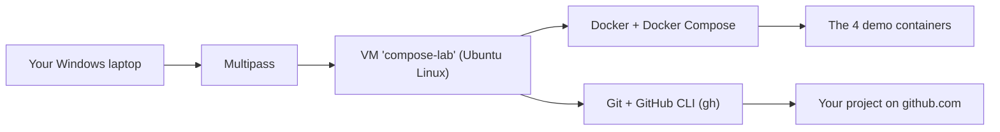

# 01 - Setup from zero

This guide starts with **nothing installed** and ends with the finished demo.
Follow the steps in order. Do not skip any step.

**Back to:** [README](../README.md) · **Next:** [02 - Concepts](02-concepts.md)

---

## The big picture

The demo runs inside a small Linux computer that lives inside your Windows computer.
This small computer is called a **virtual machine (VM)**. The tool that creates it is
called **Multipass**. This way, nothing in your normal Windows setup is changed.



You install **only one program** on Windows: Multipass.
Everything else (Docker, Git, the GitHub CLI) is installed **inside the VM, automatically**,
by the file `cloud-init.yaml`.

| What | Where | Installed by |
|---|---|---|
| Multipass | Windows | You (step 4) |
| Ubuntu 24.04 VM called `compose-lab` | Inside Multipass | `Start-Demo.bat` (automatic) |
| Docker Engine + Docker Compose | Inside the VM | `cloud-init.yaml` (automatic) |
| Git + GitHub CLI (`gh`) | Inside the VM | `cloud-init.yaml` (automatic) |
| The 4 images (nginx, mysql, adminer, busybox) | Inside the VM | `cloud-init.yaml` (automatic) |

---

## Part A: Prepare Windows (one time, about 15 minutes)

### Step 1: Check your Windows edition

1. Press the **Windows key + R**. A small "Run" window opens.
2. Type `winver` and press **Enter**.
3. Read the window. It must say **Windows 10 Pro** or **Windows 11 Pro** (or Enterprise or Education).

**Why?** Multipass uses **Hyper-V**, the virtual machine feature of Windows.
Hyper-V is only included in the Pro, Enterprise and Education editions, not in Windows Home.
On Windows Home, Multipass needs VirtualBox instead. See [Troubleshooting](09-troubleshooting.md).

### Step 2: Turn on Hyper-V

1. Right-click the **Start** button and choose **Terminal (Admin)** or **Windows PowerShell (Admin)**.
2. Click **Yes** when Windows asks for permission.
3. Type this command and press **Enter**:

   ```powershell
   Enable-WindowsOptionalFeature -Online -FeatureName Microsoft-Hyper-V -All
   ```

4. If it asks to restart, type **Y** and press **Enter**. If it says Hyper-V is already on, that is fine.

**What does this command do?** `Enable-WindowsOptionalFeature` turns on a part of Windows that is
switched off by default. `-Online` means "this running Windows". `-FeatureName Microsoft-Hyper-V`
names the part. `-All` also turns on the tools that belong to it.

### Step 3: Set your Wi-Fi network to Private

1. Open **Settings** → **Network & internet** → **Wi-Fi**.
2. Click your network's **properties**.
3. Choose **Private network**.

**Why?** On a **Public** network, Windows blocks the connection between your laptop and the VM.

### Step 4: Install Multipass

1. Open <https://canonical.com/multipass/install> in your browser.
2. Download the **Windows** installer and run it.
3. Click **Yes** when it asks for administrator permission.
4. If it asks which "driver" to use, choose **Hyper-V**.
5. When it is finished, **restart Windows**.

### Step 5: Check that Multipass works

1. Open the Start menu, type `powershell`, and press **Enter** (a normal window, not Admin).
2. Type:

   ```powershell
   multipass version
   ```

3. You should see a line like `multipass  1.x.x`. If you see an error, restart Windows and try again.

### Step 6: Create a free GitHub account (for the upload part)

1. Open <https://github.com> and click **Sign up**.
2. Follow the steps and confirm your email address.
3. Remember your **username**. Your project will live at `https://github.com/<your-username>/compose-demo`.

You can skip this step if you only want to watch the demo. Then the script simply skips the upload.

---

## Part B: Get the project and run it

### Step 7: Download and extract the project

1. On the project's GitHub page, click the green **Code** button → **Download ZIP**.
   (Or use the ZIP file that you were given.)
2. Open your **Downloads** folder.
3. Right-click the ZIP file → **Extract All** → **Extract**.
4. Open the new folder. You should see `Start-Demo.bat`, `demo.sh`, `cloud-init.yaml`, `README.md` and more.

**Important:** keep all the files together in this one folder. The launcher needs them.

### Step 8: Double-click `Start-Demo.bat`

1. Double-click **Start-Demo.bat**.
2. If a blue window says **"Windows protected your PC"**, click **More info** → **Run anyway**.
   Windows shows this for every file that was downloaded from the internet.
3. A black window opens. This is the launcher. It shows what it does, step by step:

   ```text
   [OK] Multipass is installed
   Creating the demo VM 'compose-lab'. This happens only the first time and takes about 10 minutes...
   ```

4. **Wait.** The first time, Multipass downloads Ubuntu and `cloud-init.yaml` installs Docker,
   Git, the GitHub CLI and the 4 images. Do not close the window.
5. Then you see:

   ```text
   [OK] The VM is ready
   [OK] Copied the project into the VM
   [OK] VM address: 172.x.x.x   (website: http://172.x.x.x:8080   Adminer: http://172.x.x.x:8081)
   ```

### Step 9: The checks ("Getting ready")

The demo script now checks everything and prints one `[OK]` line for each check:
Docker, Docker Compose, the compose file, the images, Git, and a **safety fingerprint** of all
project files (used again in Part 10).

### Step 10: The one-time GitHub login

The first time, the script asks:

```text
Upload the project to GitHub at the end?
Type y and press Enter for Yes. Just press Enter for No. (No after 30 seconds):
```

Type **y** and press **Enter** if you want the upload. Then a box called **ONE-TIME GITHUB LOGIN** appears:

1. A one-time code appears, for example `ABCD-1234`. Copy it.
2. If it asks **"Authenticate Git with your GitHub credentials?"**, press **Enter** (Yes).
3. If it says **"Press Enter to open github.com in your browser"**, press **Enter**.
   The VM has no browser, so nothing opens there. That is normal.
4. On your laptop, open **<https://github.com/login/device>**, sign in, type the code, and click **Authorize**.
5. Go back to the black window and wait. It continues by itself.

The login asks for one extra permission called **workflow**. GitHub needs it to accept the files
in `.github/workflows/` (the automatic tests). If you logged in with an older version of this
project, the script asks for this permission once, in a box called **ONE-TIME GITHUB PERMISSION**.
The steps are the same.

**The login is remembered.** The next runs never ask again.

### Step 11: Press Enter, then watch

When you see **Press Enter to start the demo**, press **Enter**. From now on, everything is automatic:

- Every part starts on a clean screen with a title like `PART 5 of 12 - Start the whole app`.
- A **NEXT COMMAND** box explains the next command in simple English.
- The green line starting with `$` is the real command. Below it is its real output.
- A **LOOK AT THE RESULT** box explains what the output means.
- In **Part 5**, the website and Adminer **open in your browser by themselves**.
  Click back on the black window to keep watching.
- At the end, the **final confirmation screen** lists every check, and your GitHub page opens.

While it runs: **Enter** skips a pause, **p** pauses, **Ctrl+C** stops.

### Step 12: The final confirmation

The last screen looks like this:

```text
+==============================================================================+
|                   SUCCESS - THE WHOLE PROCESS IS COMPLETE                    |
+==============================================================================+

  Result of every check (15 passed, 0 failed):
    [PASSED] All 4 containers started and are running
    [PASSED] The website answered on port 8080
    ...
    [PASSED] Uploaded to GitHub and verified: GitHub has commit 1a2b3c4

  The entire project has been uploaded to GitHub, and the upload was verified.
    Project page:      https://github.com/<your-username>/compose-demo
    Automatic tests:   https://github.com/<your-username>/compose-demo/actions
```

---

## Part C: Every run after the first one

1. Double-click **Start-Demo.bat**.
2. Press **Enter** when it says **Press Enter to start the demo**.

That is all. The VM already exists, the login is remembered, and the project folder in the VM
is updated with the files from your Windows folder (your Git history is kept).

---

## Part D: Without the launcher (by hand)

You can do everything the launcher does yourself. This is useful on macOS and Linux,
because `Start-Demo.bat` only works on Windows.

### 1. Create the VM

macOS: install Multipass from <https://canonical.com/multipass/install>.
Linux: `sudo snap install multipass`.
Then, in a terminal, inside the project folder:

```bash
multipass launch 24.04 --name compose-lab --cpus 2 --memory 4G --disk 15G --cloud-init cloud-init.yaml --timeout 1500
```

| Part of the command | Meaning |
|---|---|
| `multipass launch 24.04` | Create a new VM with Ubuntu 24.04 |
| `--name compose-lab` | Call it `compose-lab` |
| `--cpus 2 --memory 4G --disk 15G` | Give it 2 processor cores, 4 GB of memory and 15 GB of disk |
| `--cloud-init cloud-init.yaml` | Set it up with this file (installs Docker, Git, gh, the images) |
| `--timeout 1500` | Wait up to 1500 seconds (25 minutes) for the setup |

### 2. Check that the setup is finished

```bash
multipass exec compose-lab -- cloud-init status --wait
multipass exec compose-lab -- cat /home/ubuntu/LAB-READY.txt
```

You should see `status: done` and then `COMPOSE LAB READY` with the versions of Docker, Compose, Git and gh.

### 3. Go into the VM and get the project

```bash
multipass shell compose-lab
git clone https://github.com/gh-shad/compose-demo.git
cd compose-demo
```

`multipass shell` opens a terminal inside the VM. Your prompt changes to `ubuntu@compose-lab:~$`.
`git clone` downloads the project from GitHub.

### 4. Run the demo

```bash
./demo.sh
```

### 5. Find the VM's address for the browser

```bash
hostname -I
```

The first number is the address. Open `http://<that address>:8080` and `http://<that address>:8081`
in your browser during Parts 5 to 8.

---

## Part E: Stop or delete the VM

| Goal | Command (in Windows PowerShell or a macOS/Linux terminal) |
|---|---|
| Stop the VM (keeps everything) | `multipass stop compose-lab` |
| Start it again | `multipass start compose-lab` |
| See all VMs and their state | `multipass list` |
| Delete the VM completely | `multipass delete compose-lab` then `multipass purge` |

Deleting the VM does **not** delete your project on GitHub.

---

**Next:** [02 - Concepts](02-concepts.md)
