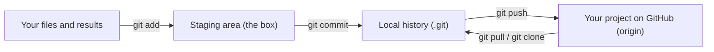
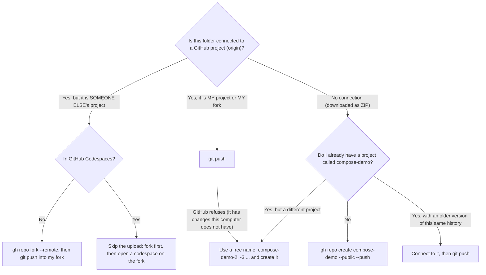

# 05 - Git and GitHub

This page explains Parts 11, 12 and 13 of the demo: how the project and the results are saved with
**Git**, how they are uploaded to **your own GitHub**, how the upload is **verified**, how the
computer **signs out** again, and how GitHub **tests** the project automatically. To do every step yourself, see
[10 - GitHub by hand](10-github-by-hand.md).

**Back to:** [README](../README.md) · **Previous:** [04 - Walkthrough](04-demo-walkthrough.md) · **Next:** [06 - Every file explained](06-files-explained.md)

---

## The tools

| Tool | What it is | Where it comes from |
|---|---|---|
| **Git** | Version control: saves every version of the project, on your computer | VM: `cloud-init.yaml`. Codespaces: already there |
| **GitHub** | The website that keeps Git projects online | A free account |
| **GitHub CLI (`gh`)** | GitHub's official command-line tool: sign in, fork, create projects, read GitHub data | VM: `cloud-init.yaml`. Codespaces: `.devcontainer/devcontainer.json` |



---

## Part 11: saving with Git, step by step

### 1. Who are you? (`git config`)

Git writes a **name** and an **email** into every commit. The script handles this by itself:

| Situation | What the script does |
|---|---|
| A name and email are already set (always true in Codespaces) | Shows them: `git config --global user.name` and `user.email` |
| Not set, but GitHub is connected | Uses your GitHub name and GitHub's private address `ID+username@users.noreply.github.com`, so your real email never becomes public |
| Not set, and no GitHub | Uses `Docker Compose Demo` and `demo@example.com` |

### 2. Start tracking (`git init -b main`)

`git init` turns the folder into a **repository** and creates the hidden `.git` folder, where the
whole history is kept. `-b main` names the main branch `main`. If the folder is already a
repository (for example a clone of your fork), the script shows `git log --oneline` instead.

### 3. Real links in the documentation (`sed`)

The documentation contains example links like `gh-shad/compose-demo-2`. When you upload a
**new** project, the script replaces them with your real address first, so the badges and links
work. In a fork, the links keep pointing to the original project, which is correct.

### 4. The results report (`results/latest-run.md`)

The script writes the report of this run: the result, the date, where it ran, every check, the
key results, the time of each part and the tool versions. `head -14 results/latest-run.md`
shows its top. This file is saved and uploaded together with the project.

### 5. See, add, save (`git status`, `git add .`, `git commit`)

| Command | Meaning | Codes you see |
|---|---|---|
| `cat .gitignore` | The files that Git must never save | — |
| `git status --short` | What Git sees right now | `??` = new file. `M` = changed file. `D` = deleted file |
| `git add .` | Put every file (except the ignored ones) into the staging area | — |
| `git status --short` | What is in the box now | `A` = added. `M` = modified |
| `git commit -m "message"` | Save the box as a new commit | The short commit ID and how many files changed |
| `git log --oneline` | The history, newest first | `1a2b3c4 Add Docker Compose ...` |

### 6. Tracking a change (`git diff`)

To show how Git notices changes, the script adds one line to `results/run-history.md`:

```text
| 13 Nov 2026, 14:05:09 | 15 of 15 checks passed | GitHub Codespaces |
```

`git diff` shows it with a `+`. `git commit -am "Record demo run on ..."` saves it
(`-a` = every changed tracked file, `-m` = message).

---

## Part 12: uploading to GitHub, step by step

### 1. Signing in

| Where | How you are signed in |
|---|---|
| **GitHub Codespaces** | Automatically. The codespace has a temporary key for your repository. Nothing to do |
| **VM or Linux** | In "Getting ready", if you answer **y** (or use `--push`): `gh auth login --hostname github.com --git-protocol https --web --scopes workflow`. You type a one-time code at <https://github.com/login/device>. Your password is never typed in the terminal. Because Part 13 signs out at the end, every run that uploads asks for a new code (with `--stay-signed-in`, only the first one) |

`--scopes workflow` adds the permission that GitHub needs to accept the files in `.github/workflows/`.
If you signed in earlier without it, the script asks once: `gh auth refresh --hostname github.com --scopes workflow`.

| Command | Meaning |
|---|---|
| `gh auth status` | Which account is signed in. The key is shown as `gho_****` |
| `gh auth setup-git` | (Not in Codespaces.) Lets Git use gh's sign-in when it pushes |

### How the script decides where to upload

The script **never overwrites or deletes** anything on GitHub. It never uses `git push --force`.



| Situation | Example | What happens |
|---|---|---|
| Your own project or fork | A codespace on your fork, or you ran the demo before | `git push -u origin main` uploads the new commits |
| Someone else's project | You used `git clone` on another person's project | `gh repo fork --remote` creates **your fork**. The old link `origin` is renamed to `upstream`, your fork becomes `origin`, then `git push` |
| No Git connection | You downloaded the ZIP | `gh repo create compose-demo --public --source=. --remote=origin --push`, then topics are added with `gh repo edit --add-topic` |
| Name already used by a different project | You have an unrelated `compose-demo` | A free name like `compose-demo-2` is used. Nothing is deleted |
| GitHub refuses the push | GitHub has commits that this computer does not have | Nothing is overwritten: the script uploads to a free new name. To combine both instead, use `git pull` ([10](10-github-by-hand.md#step-8-download-changes-pull)) |

`-u` in `git push -u origin main` means "remember this connection", so next time `git push` is enough.

### 2. Verifying the upload

The script does not just *hope* it worked. It **asks GitHub**:

| Command | Prints |
|---|---|
| `git status` | `Your branch is up to date with 'origin/main'` |
| `git rev-parse HEAD` | The full ID of the newest commit **on this computer** |
| `git ls-remote origin refs/heads/main` | The full ID of the newest commit **on GitHub** (asked over the network) |

If both IDs are **exactly the same**, the upload is verified, and the final screen says
**"The project and the results have been uploaded to GitHub, and the upload was verified."**,
followed by the links to the project, the results report, the run history and the automatic tests.

Then, when GitHub allows it, `gh api repos/<you>/<project>/contents --jq '.[].name'` lists the
files on GitHub, and `gh run list` shows the automatic test run that just started.

## Part 13: signing out, step by step

Signing in, uploading and **signing out** together make one safe GitHub session. Part 13 runs
after every upload (outside Codespaces):

| Command | Meaning |
|---|---|
| `gh auth logout --hostname github.com --user <you>` | Deletes gh's saved key from this computer |
| `git config --global --remove-section credential.https://github.com` | Deletes Git's setting to use that key (also for `gist.github.com`) |
| `sed -i '/github\.com/d' ~/.git-credentials` | Only if that file exists: deletes saved GitHub passwords |
| `gh auth status` | Checks: `You are not logged into any GitHub hosts` |

The check **"Signed out of GitHub on this computer (GitHub CLI and Git)"** is recorded, and the
final screen shows **[OK] This computer is signed out of GitHub.** A last box explains how to
**revoke** the key on github.com (Settings → Applications → GitHub CLI → Revoke access),
because `gh auth logout` removes the key from this computer but does not cancel it on GitHub.

| Option | Effect |
|---|---|
| *(default)* | Part 13 signs out |
| `--stay-signed-in` | Part 13 is skipped. Use it only on your own private computer |
| `--logout` | Only signs out (no demo). Use it after `--stay-signed-in`, or if a run was stopped early |

In **Codespaces**, Part 13 only explains: the codespace's temporary key stops working when the
codespace is stopped or deleted. Why signing out on the website is not enough:
[10 - Signing in and signing out](10-github-by-hand.md#signing-in-and-signing-out).

---

## GitHub Actions: the automatic tests

The file `.github/workflows/demo-test.yml` tells GitHub what to do **after every push** to `main`
(and when you click **Run workflow** in the Actions tab):

| Job | Runs on | Steps |
|---|---|---|
| **Check the files** | Ubuntu | Downloads the project (`actions/checkout`), checks `demo.sh` with **ShellCheck** (finds mistakes in shell scripts), checks the compose file with `docker compose config --quiet` |
| **Run the whole Docker demo** | Ubuntu | Runs `bash demo.sh --fast --no-git`: Parts 1 to 10 with the **real** images. Then it shows `results/latest-run.md` on the run's **summary page**, and saves it as a downloadable **artifact** called `demo-results` |
| **Check the Windows launcher** | Windows | Checks `Start-Demo.ps1` for mistakes with **Windows PowerShell 5.1** |

| Where | What you see |
|---|---|
| The badge at the top of the README | **passing** (green) or **failing** (red) |
| The **Actions** tab → a run | The summary page with the full results report, and the **Artifacts** section |
| A job → a step | Its complete output, every command and every explanation |

`permissions: contents: read` means the tests may only **read** the project. They never upload anything.
In a **new fork**, open the Actions tab once and click **I understand my workflows, go ahead and enable them**.

---

**Next:** [06 - Every file explained](06-files-explained.md)
