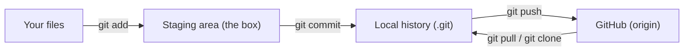
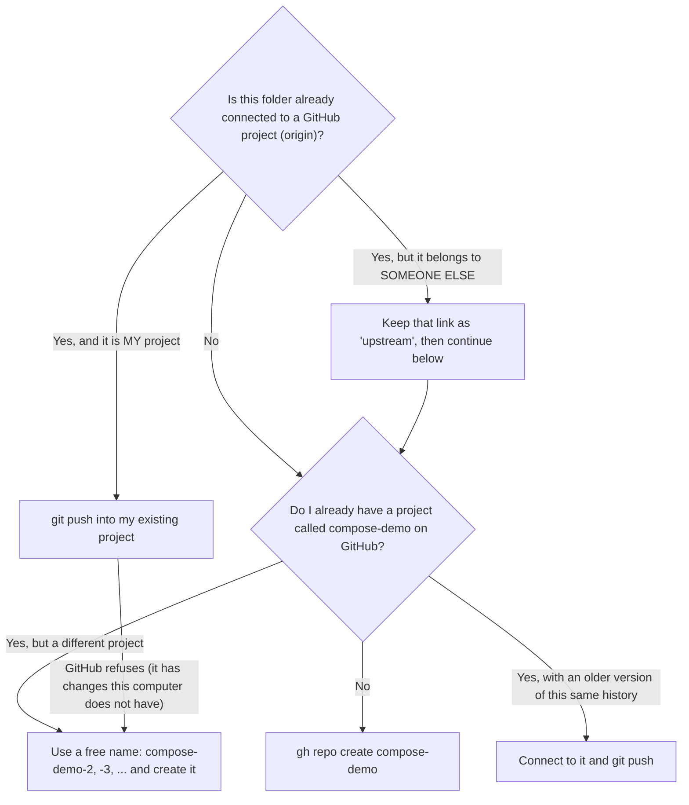

# 05 - Git and GitHub

This page explains Parts 11 and 12 of the demo: how the project is saved with **Git**, how it
is uploaded to **GitHub**, how the upload is **verified**, and how GitHub **tests** it automatically.

**Back to:** [README](../README.md) · **Previous:** [04 - Walkthrough](04-demo-walkthrough.md) · **Next:** [06 - Every file explained](06-files-explained.md)

---

## The tools

| Tool | What it is | Installed by |
|---|---|---|
| **Git** | Version control: saves every version of the project, on your computer | `cloud-init.yaml` |
| **GitHub** | The website that keeps Git projects online | (a free account) |
| **GitHub CLI (`gh`)** | GitHub's official command-line tool: login, create projects, read GitHub data | `cloud-init.yaml` |



---

## Part 11: saving with Git, step by step

### 1. Who are you? (`git config`)

Git writes a **name** and an **email** into every commit. The script handles this by itself:

| Situation | What the script does |
|---|---|
| A name and email are already set | Shows them: `git config --global user.name` and `git config --global user.email` |
| Not set, but GitHub is connected | Uses your GitHub name and GitHub's private address `ID+username@users.noreply.github.com`, so your real email never becomes public |
| Not set, and no GitHub | Uses `Docker Compose Demo` and `demo@example.com` |

`--global` means: for all projects of this user on this computer.

### 2. Start tracking (`git init -b main`)

`git init` turns the folder into a **repository**. It creates the hidden folder `.git`, where
the whole history is kept. `-b main` names the main branch `main`.
If the folder is already a repository, the script shows the history with `git log --oneline` instead.

### 3. Real links in the documentation (`sed`)

The documentation contains example links like `gh-shad/compose-demo`. Before saving,
the script replaces them with your real address, for example `student123/compose-demo`, so the
test badge and the links work. It only touches the `.md` files that still contain the example.

### 4. What is never saved (`.gitignore`)

`cat .gitignore` shows the list: `.env` (passwords), `*.log` (log files), editor and system
files, and `*.tar` (update packages of the Windows launcher).

### 5. See, add, save (`git status`, `git add .`, `git commit`)

| Command | Meaning | Codes you see |
|---|---|---|
| `git status --short` | What Git sees right now | `??` = new file, not tracked yet. `M` = changed file |
| `git add .` | Put every file (except the ignored ones) into the staging area. `.` = this folder | — |
| `git status --short` | What is in the box now | `A` = added. `M` = modified |
| `git commit -m "message"` | Save the box as a new commit with a message | Git prints the short commit ID and how many files changed |
| `git log --oneline` | The history, one line per commit, newest first | `1a2b3c4 Add Docker Compose ...` |

### 6. Tracking a change (`git diff`)

To show how Git notices changes, the script adds one line to `docs/demo-runs.md`:

```text
| 12 Nov 2026, 14:05:09 | 14 of 14 checks passed |
```

| Command | Meaning |
|---|---|
| `git diff` | Shows exactly what changed. Lines with `+` were added, lines with `-` were removed |
| `git commit -am "Record demo run on ..."` | `-a` = add every changed (already tracked) file, `-m` = message. Add and save in one step |

---

## Part 12: uploading to GitHub, step by step

### 1. The one-time login (`gh auth login`)

Done in "Getting ready", only the first time:

```bash
gh auth login --hostname github.com --git-protocol https --web --scopes workflow
```

| Part | Meaning |
|---|---|
| `--hostname github.com` | Log in to github.com |
| `--git-protocol https` | Git talks to GitHub over HTTPS (normal web traffic) |
| `--web` | Log in with a one-time code in the browser. **Your password is never typed in the terminal** |
| `--scopes workflow` | Also ask for the `workflow` permission (needed to upload `.github/workflows/`) |

GitHub always gives `gh` the basic permissions `repo`, `read:org` and `gist`.
If you logged in earlier without `workflow`, the script asks for it once with:
`gh auth refresh --hostname github.com --scopes workflow`.

### 2. Checking the login

| Command | Meaning |
|---|---|
| `gh auth status` | Which account is logged in, and its permissions. The token is shown as `gho_****` |
| `gh auth setup-git` | Tells Git to use `gh`'s login when it pushes, so Git never asks for a password |

### How the script decides where to upload

The script **never overwrites or deletes** anything on GitHub. It chooses like this:



| Situation | Example | What happens |
|---|---|---|
| Your existing project | You ran the demo before | `git push -u origin main` uploads the new commits into the **same** repository |
| First time | New VM, new account | `gh repo create compose-demo --public --source=. --remote=origin --push` |
| Downloaded from someone else | You used `git clone` on another person's project | `git remote rename origin upstream`, then your **own** copy is created |
| Name already used by a different project | You have an unrelated `compose-demo` | A free name like `compose-demo-2` is used. **Nothing is deleted** |

`-u` in `git push -u origin main` means "remember this connection", so next time plain `git push` is enough.

### 3. Public, with a description and topics

| Command | Meaning |
|---|---|
| `gh repo view <you>/<project> --json visibility` | Checks if the project is public or private |
| `gh repo edit <you>/<project> --visibility public --accept-visibility-change-consequences` | Only if it is private: makes it public, so anyone can learn from it |
| `gh repo edit <you>/<project> --description "..." --add-topic docker,docker-compose,...` | Sets the description and **topics** (search tags), so people can find the project |

### 4. Verifying the upload

The script does not just *hope* the upload worked. It **asks GitHub**:

| Command | Prints |
|---|---|
| `git status` | `Your branch is up to date with 'origin/main'` |
| `git rev-parse HEAD` | The full ID of the newest commit **on this computer** |
| `gh api repos/<you>/<project>/commits/main --jq .sha` | The full ID of the newest commit **on GitHub** |

If both IDs are **exactly the same**, the upload is verified, and the final screen says
**"The entire project has been uploaded to GitHub, and the upload was verified."**

`gh api` talks directly to GitHub's API (the interface programs use to talk to GitHub).
`--jq .sha` picks one value out of GitHub's answer.

Then `gh api repos/<you>/<project>/contents --jq '.[].name'` lists the files GitHub now has.

---

## GitHub Actions: the automatic tests

The file `.github/workflows/demo-test.yml` tells GitHub what to do **after every push** to
`main` (and when you click **Run workflow** in the Actions tab):

| Job | Runs on | Steps |
|---|---|---|
| **Check the files** | Ubuntu | Downloads the project (`actions/checkout`), checks `demo.sh` with **ShellCheck** (a tool that finds mistakes in shell scripts), checks the compose file with `docker compose config --quiet` |
| **Run the whole Docker demo** | Ubuntu | Runs `bash demo.sh --fast --no-git`: Parts 1 to 10 with the **real** images. If any check fails, the script's exit code is 1 and the job turns red |
| **Check the Windows launcher** | Windows | Checks `Start-Demo.ps1` for mistakes with **Windows PowerShell 5.1** |

| Where | What you see |
|---|---|
| The badge at the top of the README | **passing** (green) or **failing** (red) |
| The **Actions** tab | Every run. Click one, then a job, then a step, to read its full output |
| `gh run list --repo <you>/<project>` | The same list in the terminal |

`permissions: contents: read` in the workflow file means the tests may only **read** the project.
They cannot change anything.

---

## Doing it all by hand

```bash
# once per computer
git config --global user.name "Your Name"
git config --global user.email "ID+username@users.noreply.github.com"
gh auth login --hostname github.com --git-protocol https --web --scopes workflow

# once per project
cd compose-demo
git init -b main
git add .
git commit -m "Add Docker Compose multi-container demo"
gh repo create compose-demo --public --source=. --remote=origin --push

# every time you change something
git status
git diff
git add .
git commit -m "Describe what you changed"
git push
```

Your noreply address is shown on GitHub: **Settings** → **Emails** → "Keep my email addresses private".

## Getting the project on another computer

```bash
git clone https://github.com/gh-shad/compose-demo.git
cd compose-demo
./demo.sh
```

To get newer changes later: `git pull`.

---

**Next:** [06 - Every file explained](06-files-explained.md)
