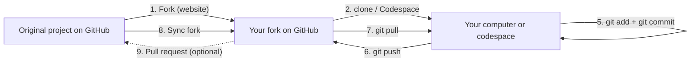

# 10 - GitHub by hand: fork, change, run, push, pull, sign out

`demo.sh` can do the GitHub part for you. This page shows how to do **every step yourself**,
so you understand it and can use it in any project.

**Back to:** [README](../README.md) · **Previous:** [09 - Troubleshooting](09-troubleshooting.md)

---

## The big picture



| Word | Meaning |
|---|---|
| **Fork** | Your own copy of someone else's project, on GitHub. It stays linked to the original |
| **Clone** | Download a project from GitHub to your computer (with its full history) |
| **Commit** | A save point in your project's history |
| **Push** | Upload your new commits to GitHub |
| **Pull** | Download new commits from GitHub |
| **Sync fork** | Bring the newest changes of the original project into your fork |
| **Pull request** | Ask the owner of the original project to take your change |

---

## Step 1: Fork the project (on the website)

1. Sign in to <https://github.com>.
2. Open the project page, for example `https://github.com/gh-shad/compose-demo-2`.
3. Click **Fork** (top right) → **Create fork**.
4. You now have `https://github.com/<you>/compose-demo`. Everything below happens in **your** fork.

Why fork? You cannot upload into another person's project. Your fork is yours: you can push
to it freely, and the original stays untouched.

---

## Step 2: Open your fork somewhere you can run it

### Option A: GitHub Codespaces (nothing to install)

1. On **your fork's** page, click the green **Code** button → **Codespaces** tab → **Create codespace on main**.
2. Wait about 1 to 2 minutes. A code editor opens in your browser, with a **terminal** at the bottom.
3. You are already signed in to GitHub there. Skip Step 3.

### Option B: your own Linux computer or the Multipass VM

```bash
git clone https://github.com/<you>/compose-demo.git
cd compose-demo
```

`git clone` downloads your fork and connects the folder to it. That connection is called `origin`.

---

## Step 3: Sign in to GitHub (only for Option B)

```bash
gh auth login --hostname github.com --git-protocol https --web --scopes workflow
gh auth setup-git
git config --global user.name "Your Name"
git config --global user.email "ID+username@users.noreply.github.com"
```

| Command | What it does |
|---|---|
| `gh auth login ... --web` | Signs in with a one-time code at <https://github.com/login/device>. Your password is never typed in the terminal |
| `gh auth setup-git` | Lets Git use that sign-in for `git push` |
| `git config --global user.name / user.email` | The name and email written into your commits. Your private noreply address is on GitHub: **Settings** → **Emails** |

---

## Step 4: Change something

Example: open `html/index.html` and change the title text inside `<h1> ... </h1>`.

- In Codespaces: click the file on the left, edit, and it saves by itself.
- In a terminal: `nano html/index.html`, edit, then **Ctrl+O**, **Enter**, **Ctrl+X**.

---

## Step 5: Run Docker Compose after your change

| What you changed | What to run | Why |
|---|---|---|
| A file in `html/` | Nothing. Just **refresh** the browser | The folder is mounted into NGINX, so it sees the new file at once |
| `docker-compose.yml` | `docker compose up -d` | Compose compares the file with what is running and re-creates only the changed services |
| An image version (for example `mysql:8.4` → another tag) | `docker compose pull` then `docker compose up -d` | Downloads the new image, then starts it |
| You want a completely fresh start | `docker compose down --volumes` then `docker compose up -d` | Removes everything (including the data), then starts again |

Useful commands while it runs:

```bash
docker compose ps                  # what is running, and on which ports
docker compose logs web --tail 20  # the last 20 messages of the web service
curl -s http://localhost:8080 | grep '<title>'    # check the page from the terminal
docker compose down                # stop and remove the containers (data stays)
```

Or run the whole automatic demo again: `./demo.sh` (it does all of this, and writes a new report).

---

## Step 6: See the output and the results

| What | Where |
|---|---|
| The website | Multipass VM: `http://<VM address>:8080` (`hostname -I` shows the address). Codespaces: the **Ports** tab → port **8080** → globe icon |
| Adminer | The same, port **8081** (server `db`, user `root`, password `examplepassword`) |
| The full report of the newest run | `results/latest-run.md` (open it in the editor, or `cat results/latest-run.md`) |
| One line per run | `results/run-history.md` |
| The results on GitHub | `https://github.com/<you>/compose-demo/blob/main/results/latest-run.md` |
| The automatic test results | Your fork → **Actions** tab → the newest **Demo test** run. The report is shown on its summary page, and can be downloaded under **Artifacts** → `demo-results` |

In a new fork, GitHub switches the automatic tests off until you open the **Actions** tab once
and click **I understand my workflows, go ahead and enable them**.

---

## Step 7: Save and upload (commit and push)

```bash
git status                           # what changed
git diff                             # exactly what changed
git add .                            # put the changes into the staging area (the box)
git commit -m "Change the page title" # save them as a commit
git push                             # upload to your fork on GitHub
```

Check that GitHub really has it:

```bash
git rev-parse HEAD                   # the newest commit on your computer
git ls-remote origin refs/heads/main # the newest commit on GitHub
```

Both IDs must be the same. Then open `https://github.com/<you>/compose-demo` and you see your commit.

---

## Step 8: Download changes (pull)

If something changed on GitHub (for example, you edited a file on the website, or you pushed
from another computer), download it before you work:

```bash
git pull
```

If `git push` says **rejected** ("Updates were rejected because the remote contains work that
you do not have"), GitHub has commits that your computer does not have. Fix:

```bash
git pull          # download and combine them
git push          # now the upload works
```

If both sides changed the **same lines** of a file, Git shows a **conflict** and marks the file
with `<<<<<<<`, `=======` and `>>>>>>>`. Open the file, keep the right text, delete the marks, then:

```bash
git add <file>
git commit -m "Combine both changes"
git push
```

---

## Step 9: Keep your fork up to date with the original

The easy way: on your fork's page on GitHub, click **Sync fork** → **Update branch**. Then `git pull`.

The command-line way:

```bash
git remote add upstream https://github.com/gh-shad/compose-demo-2.git   # once
git fetch upstream
git merge upstream/main
git push
```

`upstream` is the usual name for the original project. (`demo.sh` sets it up for you when it
creates a fork.)

---

## Step 10 (optional): Suggest your change to the original (pull request)

1. Push your change to your fork (Step 7).
2. On your fork's page, click **Contribute** → **Open pull request**, describe the change, and send it.

Or in the terminal: `gh pr create --fill`.

---

## Signing in and signing out

### Why am I still signed in after I signed out?

There are **separate** sign-ins, and each one must be signed out on its own:

| Where | What keeps you signed in | How to sign out |
|---|---|---|
| The **browser** | A cookie of github.com | Your picture (top right) → **Sign out** |
| The **GitHub CLI** (`gh`) on a computer or VM | A secret key (a **token**) in `~/.config/gh/hosts.yml` | `gh auth logout --hostname github.com` |
| **Git** on that computer | `gh auth setup-git` told Git to use gh's key (in `~/.gitconfig`) | `git config --global --remove-section credential.https://github.com` (and the same for `credential.https://gist.github.com`) |
| **Git on Windows** (if you ever used Git directly on Windows) | The Windows **Credential Manager** | Control Panel → **Credential Manager** → **Windows Credentials** → remove `git:https://github.com` |
| **GitHub itself** | It accepts the token until it is cancelled | <https://github.com/settings/applications> → **GitHub CLI** → **Revoke access** |

Signing out in the browser does not touch the key inside the VM. And `gh auth logout` removes
the key only from that one computer: GitHub still accepts it until you revoke it on the website.

### The demo signs out by itself (Part 13)

After every upload, **Part 13** of the demo signs out completely: it removes the gh key, Git's
GitHub settings, and GitHub lines in `~/.git-credentials`, checks the result, and shows the last
step on the website (revoke). So a complete run is one safe GitHub session: **sign in → upload →
verify → sign out**. Use `./demo.sh --stay-signed-in` only on your own private computer, if you
want to keep the sign-in for the next run.

### Sign out completely with one command (any time)

```bash
./demo.sh --logout          # inside the VM or on Linux
Start-Demo.bat --logout     # on Windows, for the Multipass VM
```

This is Part 13 on its own. Use it after `--stay-signed-in`, after a run that was stopped before
Part 13, or after signing in by hand with `gh auth login`.

### In GitHub Codespaces

A codespace uses a temporary key that GitHub creates for that codespace only. It stops working
when you stop or delete the codespace at <https://github.com/codespaces>. Nothing is stored on your own computer.

---

**Back to:** [README](../README.md)
