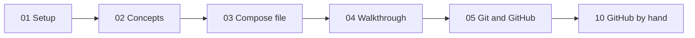

# Documentation

All guides for the **Docker Compose Demo** project, in simple English.
New here? Start with the [main README](../README.md), then follow the learning path below.

**Back to:** [README](../README.md)

---

## Learning path

| Step | Guide | Read it when you want to... | Time |
|---|---|---|---|
| 1 | [01 - Setup from zero](01-setup-from-zero.md) | Install everything and run the demo for the first time | 15 min |
| 2 | [02 - Concepts](02-concepts.md) | Understand every idea and word (with a glossary) | 20 min |
| 3 | [03 - The docker-compose.yml file](03-docker-compose-file.md) | Read the application file line by line | 10 min |
| 4 | [04 - Demo walkthrough](04-demo-walkthrough.md) | Know every command of all 13 parts, and what it shows | 20 min |
| 5 | [05 - Git and GitHub](05-git-and-github.md) | Understand saving, uploading, verifying, signing out and the automatic tests | 15 min |
| 6 | [10 - GitHub by hand](10-github-by-hand.md) | Do every Git and GitHub step yourself: fork, push, pull, sign out | 20 min |

## Reference

| Guide | What is inside |
|---|---|
| [06 - Every file explained](06-files-explained.md) | What each file of the project does, and how |
| [07 - Commands reference](07-commands-reference.md) | Every command used in the project, in one place |
| [08 - Clean up and safety](08-cleanup-and-safety.md) | What the demo creates, removes and protects |
| [09 - Troubleshooting](09-troubleshooting.md) | Problems, fixes, questions and answers |

## Security

| Guide | What is inside |
|---|---|
| [SECURITY.md](../SECURITY.md) | Every protection of the project, the demo-only choices, and how to report a problem privately |
| [08 - Clean up and safety](08-cleanup-and-safety.md) | What the demo creates, removes and protects, step by step |

## For teachers

| Guide | What is inside |
|---|---|
| [11 - Teaching guide](11-teaching-guide.md) | Learning outcomes, lesson plan, questions with answers, exercises with solutions, marking checklist, quiz |

## Screenshots

All screenshots are in [images](images/README.md). They are real screens of the demo, captured
in a terminal during a test run.

---

**Back to:** [README](../README.md)
